# 10463953 - Visual AI Edition

> A page-by-page visual companion to the optimized Markdown edition. Each embedded image is a rendered page of the original PDF, preserving figures, diagrams, plots, tables, equations, page layout, and captions.

## How to use this file

- Keep `visual_assets/` beside this Markdown file; the image links are intentionally relative.
- Use `10463953_ai_optimized.md` for searchable text, equations, tables, glossary, and structured conclusions.
- Use the page image below when visual evidence matters or when extracted text is ambiguous.
- `PDF page N` is the physical PDF index. `Thesis page N` is the printed page number inside the thesis.

## Visual figure index

| Figure group | PDF pages | Visual content |
|---|---:|---|
| Figures 1.1-1.8 | 28-32 | Prior guidance architectures, test rigs, and dual-spin concepts |
| Figures 2.1-2.14 | 35-53 | Canard architecture, torque decomposition, rig hardware, and FPGA control |
| Figures 3.1-3.9 | 55-65 | Plant model, Simulink blocks, state comparison, and transfer-function validation |
| Figures 4.1-4.24 | 70-92 | Cascade controller, root loci, Bode/step responses, and chirp tests |
| Figures 5.1-5.11 | 93-105 | Flight frames, 6-DOF/7-DOF model, forces, and aerodynamic torque |
| Figures 6.1-6.14 | 109-119 | Flight profiles, observer behavior, and adaptive-limit simulations |
| Figures 7.1-7.8 | 122-127 | Hardware and simulation comparisons for controller variants |
| Figures B.1-B.4 | 141-146 | Electrical circuit and free-body derivations |
| Figures F.1-F.3 | 162-163 | Plant reduction and disturbance-observer filter design |

## Page-by-page visual source

### PDF page 1 | thesis page n/a
<!-- source: pdf_page=1; thesis_page=n/a; section=Front matter -->
- **Section:** Front matter
- **Focus:** CONTROLLER DESIGN AND IMPLEMENTATION FOR A GUIDANCE KIT

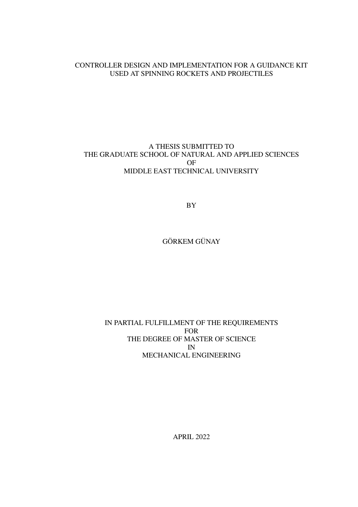

[Open page 001 as a PNG](visual_assets/page-001.png)

### PDF page 2 | thesis page n/a
<!-- source: pdf_page=2; thesis_page=n/a; section=Front matter -->
- **Section:** Front matter
- **Focus:** Blank page.

[Open page 002 as a PNG](visual_assets/page-002.png)

### PDF page 3 | thesis page n/a
<!-- source: pdf_page=3; thesis_page=n/a; section=Front matter -->
- **Section:** Front matter
- **Focus:** CONTROLLER DESIGN AND IMPLEMENTATION FOR A GUIDANCE

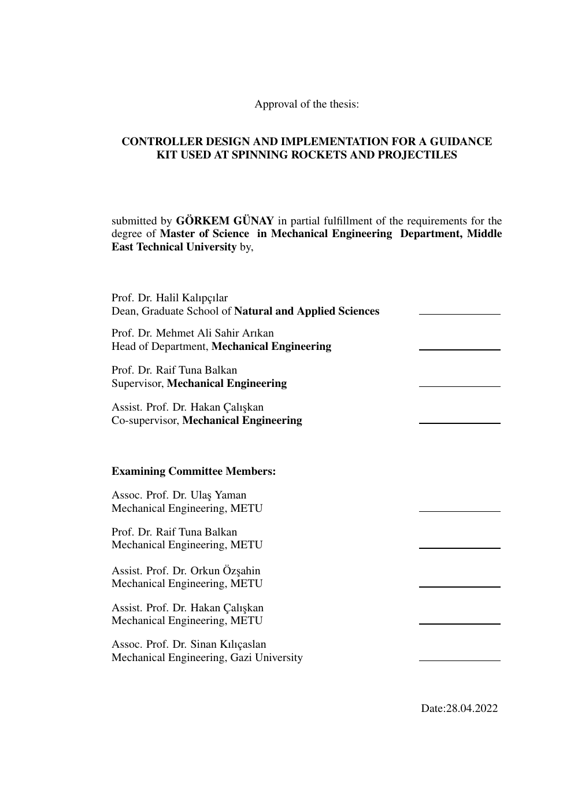

[Open page 003 as a PNG](visual_assets/page-003.png)

### PDF page 4 | thesis page iv
<!-- source: pdf_page=4; thesis_page=iv; section=Front matter -->
- **Section:** Front matter
- **Focus:** I hereby declare that all information in this document has been obtained and

[Open page 004 as a PNG](visual_assets/page-004.png)

### PDF page 5 | thesis page v
<!-- source: pdf_page=5; thesis_page=v; section=Front matter -->
- **Section:** Front matter
- **Focus:** ABSTRACT CONTROLLER DESIGN AND IMPLEMENTATION FOR A GUIDANCE

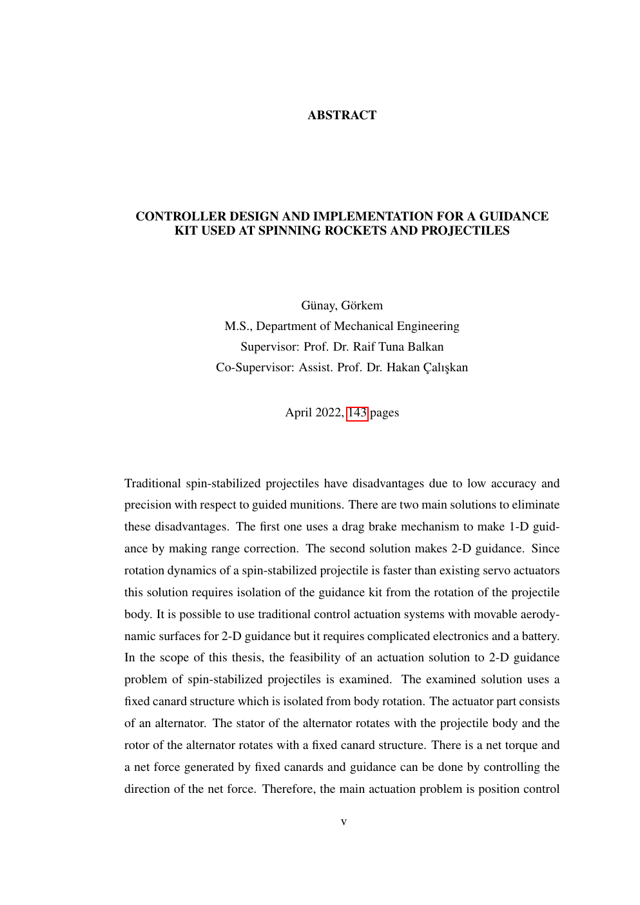

[Open page 005 as a PNG](visual_assets/page-005.png)

### PDF page 6 | thesis page vi
<!-- source: pdf_page=6; thesis_page=vi; section=Front matter -->
- **Section:** Front matter
- **Focus:** of an alternator. Since the actuation problem is reduced to one-axis position control,

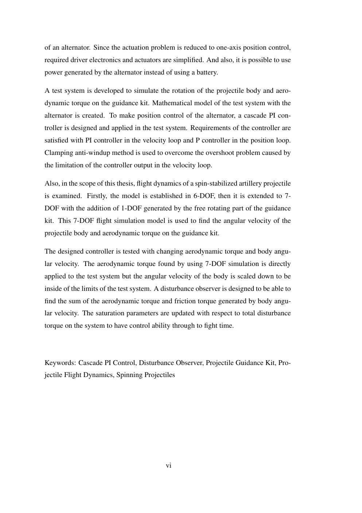

[Open page 006 as a PNG](visual_assets/page-006.png)

### PDF page 7 | thesis page vii
<!-- source: pdf_page=7; thesis_page=vii; section=Front matter -->
- **Section:** Front matter
- **Focus:** ÖZ DÖNEN ROKET VE MÜH˙IMMATLARDA KULLANILAN B˙IR GÜDÜM

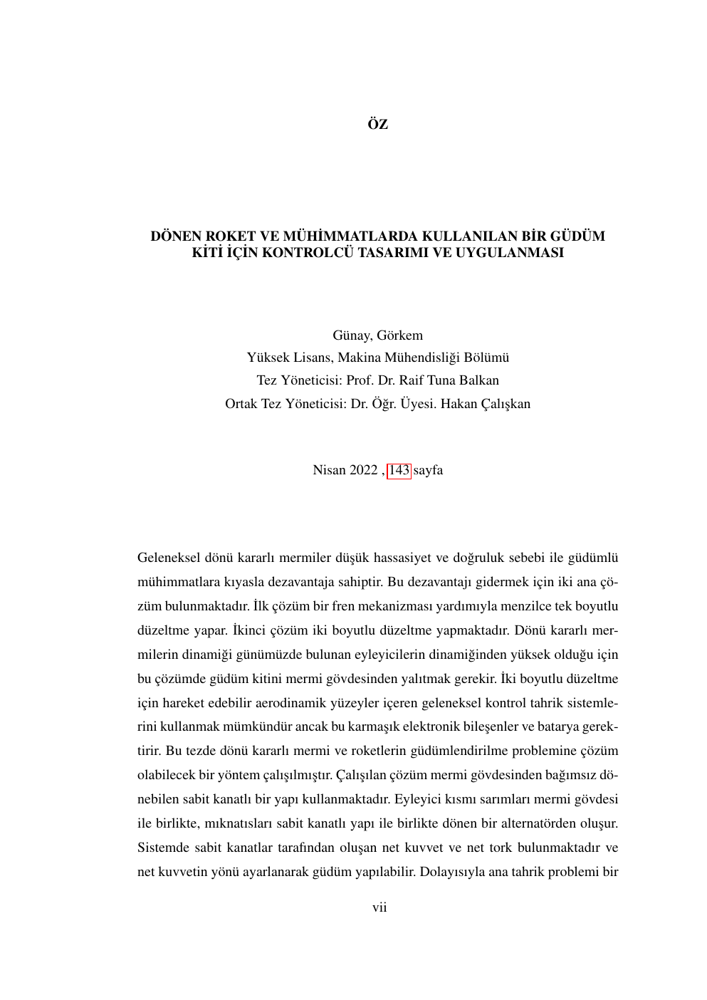

[Open page 007 as a PNG](visual_assets/page-007.png)

### PDF page 8 | thesis page viii
<!-- source: pdf_page=8; thesis_page=viii; section=Front matter -->
- **Section:** Front matter
- **Focus:** alternatörün pozisyon kontrolüdür. Temel tahrik problemi tek eksende pozisyon kontrolüne indirgendi˘ginden dolayı gerekli elektronik sistemler ve eyleyiciler basitle¸ stirilmi¸ stir. Ayrıca alternatörden elde edilen gücü batarya yerine kullanmak mümkündür.

[Open page 008 as a PNG](visual_assets/page-008.png)

### PDF page 9 | thesis page ix
<!-- source: pdf_page=9; thesis_page=ix; section=Front matter -->
- **Section:** Front matter
- **Focus:** If you want to find the secrets of the universe, think in terms of energy, frequency

[Open page 009 as a PNG](visual_assets/page-009.png)

### PDF page 10 | thesis page x
<!-- source: pdf_page=10; thesis_page=x; section=Front matter -->
- **Section:** Front matter
- **Focus:** ACKNOWLEDGMENTS Firstly, I want to give my deepest thanks to my supervisor Prof. Dr. Raif Tuna

[Open page 010 as a PNG](visual_assets/page-010.png)

### PDF page 11 | thesis page xi
<!-- source: pdf_page=11; thesis_page=xi; section=Front matter -->
- **Section:** Front matter
- **Focus:** TABLE OF CONTENTS 1 INTRODUCTION . . . . . . . . . . . . . . . . . . . . . . . . . . . . . . . 1

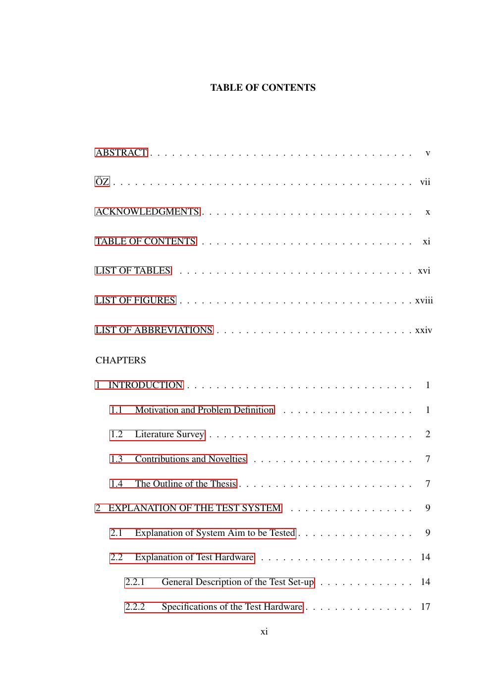

[Open page 011 as a PNG](visual_assets/page-011.png)

### PDF page 12 | thesis page xii
<!-- source: pdf_page=12; thesis_page=xii; section=Front matter -->
- **Section:** Front matter
- **Focus:** Speed Motor . . . . . . . . . . . . . . . . . . . . . . . . . . . . 17

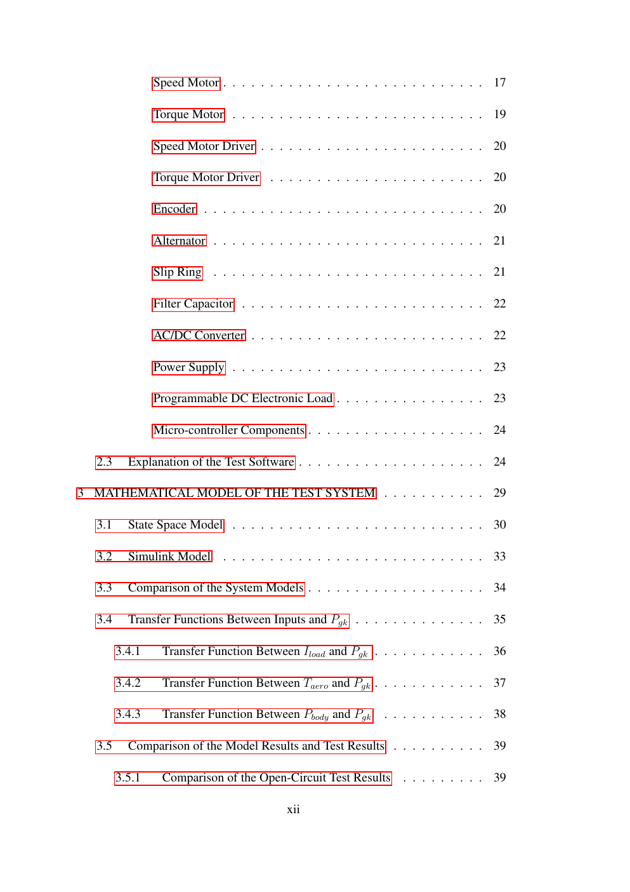

[Open page 012 as a PNG](visual_assets/page-012.png)

### PDF page 13 | thesis page xiii
<!-- source: pdf_page=13; thesis_page=xiii; section=Front matter -->
- **Section:** Front matter
- **Focus:** 3.5.2 Comparison of the Closed-Circuit Test Results . . . . . . . . . 40

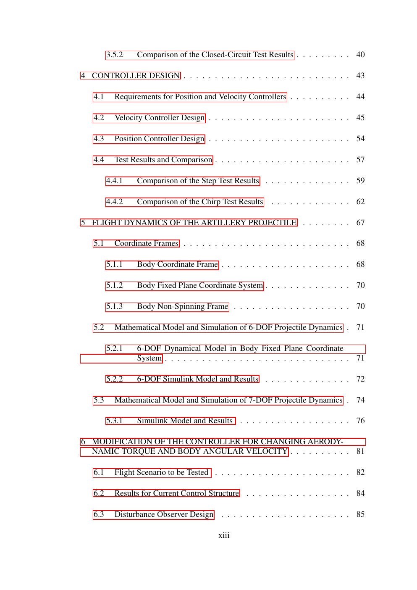

[Open page 013 as a PNG](visual_assets/page-013.png)

### PDF page 14 | thesis page xiv
<!-- source: pdf_page=14; thesis_page=xiv; section=Front matter -->
- **Section:** Front matter
- **Focus:** REFERENCES . . . . . . . . . . . . . . . . . . . . . . . . . . . . . . . . . . 107 6.4 Possible Solution Approaches . . . . . . . . . . . . . . . . . . . . . 87

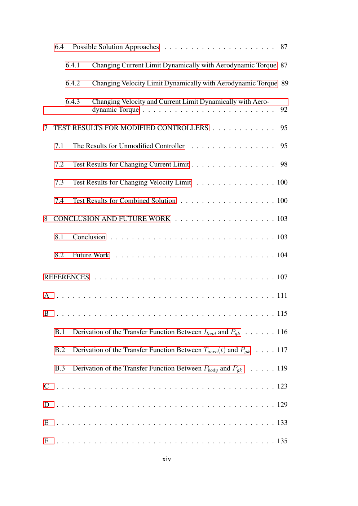

[Open page 014 as a PNG](visual_assets/page-014.png)

### PDF page 15 | thesis page xv
<!-- source: pdf_page=15; thesis_page=xv; section=Front matter -->
- **Section:** Front matter
- **Focus:** G . . . . . . . . . . . . . . . . . . . . . . . . . . . . . . . . . . . . . . . . . 139

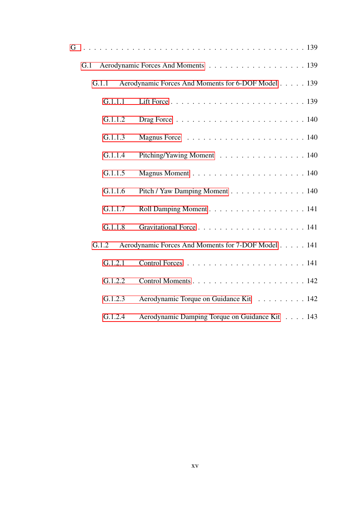

[Open page 015 as a PNG](visual_assets/page-015.png)

### PDF page 16 | thesis page xvi
<!-- source: pdf_page=16; thesis_page=xvi; section=Front matter -->
- **Section:** Front matter
- **Focus:** LIST OF TABLES Table 2.1 Axial and Angular Velocities of 155 mm Spin-Stabilized Projectile . 9 Table 2.2 Mechanical Parts of the Actuator Part of Test Set-up . . . . . . . . . 17

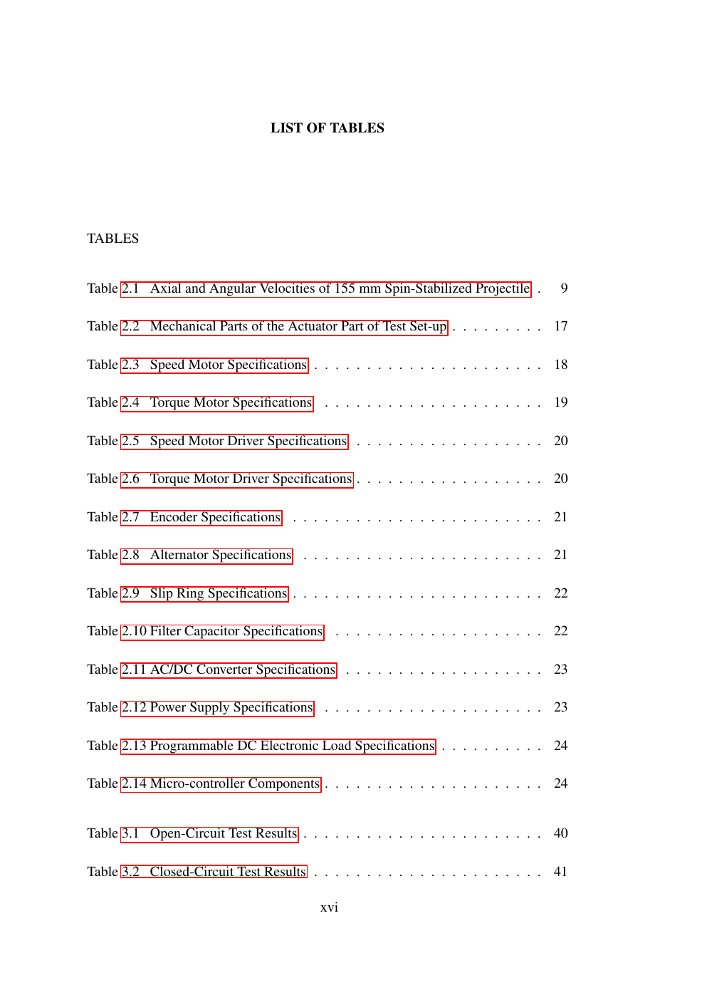

[Open page 016 as a PNG](visual_assets/page-016.png)

### PDF page 17 | thesis page xvii
<!-- source: pdf_page=17; thesis_page=xvii; section=Front matter -->
- **Section:** Front matter
- **Focus:** Table 4.1 Requirements of the Position Controller . . . . . . . . . . . . . . . 45 Table 4.2 Requirements of the Velocity Controller . . . . . . . . . . . . . . . 45

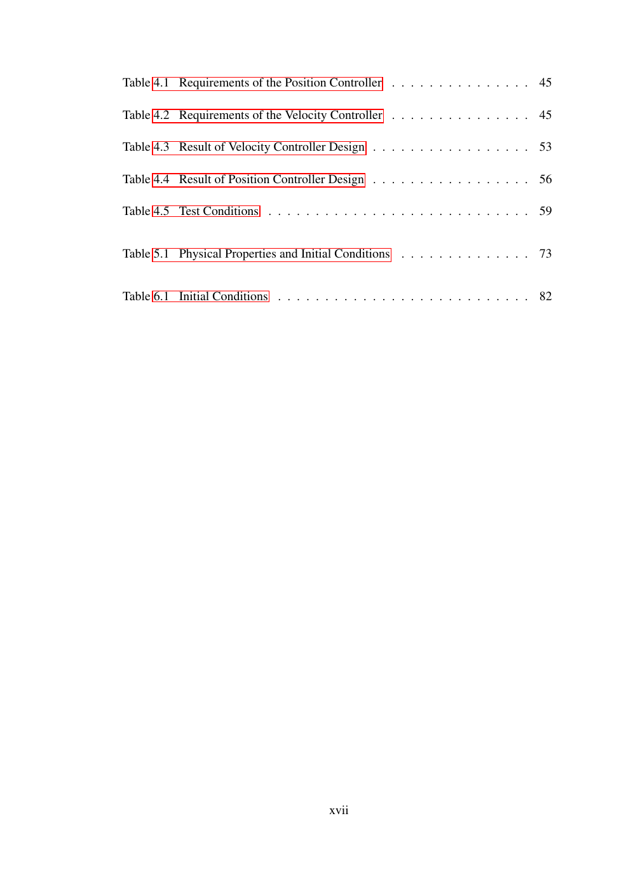

[Open page 017 as a PNG](visual_assets/page-017.png)

### PDF page 18 | thesis page xviii
<!-- source: pdf_page=18; thesis_page=xviii; section=Front matter -->
- **Section:** Front matter
- **Focus:** LIST OF FIGURES Figure 1.1 An Example Design of 1-D Control Approach by Using Drag Figure 1.2 An Example Design Which Uses Movable Aerodynamic Surfaces . . . . . . . . . . . . . . . . . . . . . . . . . . . . . . . . . . . 3 Brake . . . . . . . . . . . . . . . . . . . . . . . . . . . . . . . . . . . 2

[Open page 018 as a PNG](visual_assets/page-018.png)

### PDF page 19 | thesis page xix
<!-- source: pdf_page=19; thesis_page=xix; section=Front matter -->
- **Section:** Front matter
- **Focus:** Figure 2.8 Micro-controller Part . . . . . . . . . . . . . . . . . . . . . . . 16 Figure 2.9 AC/DC Converter and Filter Capacitor . . . . . . . . . . . . . . 16 Simulink Model . . . . . . . . . . . . . . . . . . . . . . . . . . . . . 35

[Open page 019 as a PNG](visual_assets/page-019.png)

### PDF page 20 | thesis page xx
<!-- source: pdf_page=20; thesis_page=xx; section=Front matter -->
- **Section:** Front matter
- **Focus:** Figure 4.5 Bode Plot of Velocity Loop . . . . . . . . . . . . . . . . . . . . 51 Figure 4.6 Error Due to Step Disturbance at Taero . . . . . . . . . . . . . . 52 View . . . . . . . . . . . . . . . . . . . . . . . . . . . . . . . . . . . 60

[Open page 020 as a PNG](visual_assets/page-020.png)

### PDF page 21 | thesis page xxi
<!-- source: pdf_page=21; thesis_page=xxi; section=Front matter -->
- **Section:** Front matter
- **Focus:** Figure 5.1 Torques on the Guidance Kit . . . . . . . . . . . . . . . . . . . 67 Figure 5.2 Flat Earth Inertial Reference Frame . . . . . . . . . . . . . . . . 69

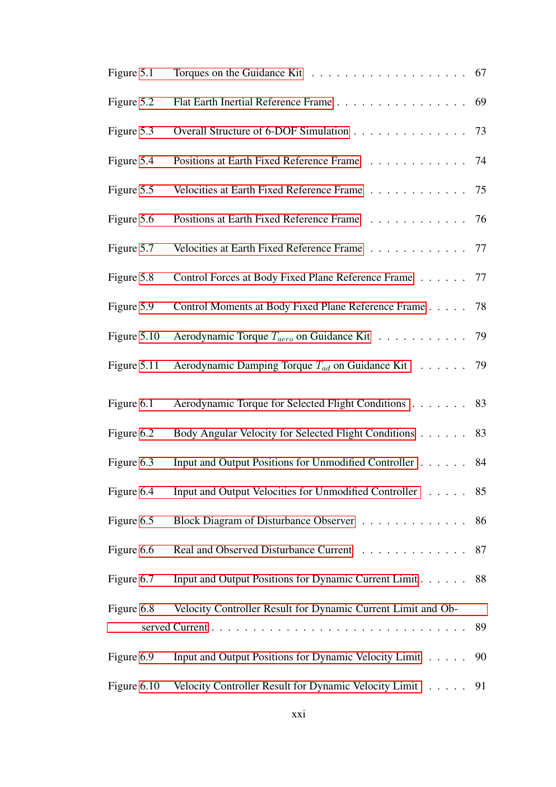

[Open page 021 as a PNG](visual_assets/page-021.png)

### PDF page 22 | thesis page xxii
<!-- source: pdf_page=22; thesis_page=xxii; section=Front matter -->
- **Section:** Front matter
- **Focus:** Figure 6.11 Velocity Controller Result for Dynamic Velocity Limit - Zoomed Figure 6.12 Input and Output Positions for Combined Solution . . . . . . . . 92 View . . . . . . . . . . . . . . . . . . . . . . . . . . . . . . . . . . . . 91

[Open page 022 as a PNG](visual_assets/page-022.png)

### PDF page 23 | thesis page xxiii
<!-- source: pdf_page=23; thesis_page=xxiii; section=Front matter -->
- **Section:** Front matter
- **Focus:** Figure F.1 Comparison of Real and Reduced Transfer Functions . . . . . . 136 Figure F.2 Bode Plot of the Filter . . . . . . . . . . . . . . . . . . . . . . . 137

[Open page 023 as a PNG](visual_assets/page-023.png)

### PDF page 24 | thesis page xxiv
<!-- source: pdf_page=24; thesis_page=xxiv; section=Front matter -->
- **Section:** Front matter
- **Focus:** LIST OF ABBREVIATIONS pbody: Angular velocity of the projectile or rocket body

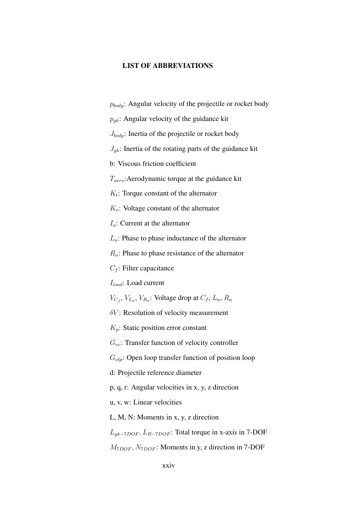

[Open page 024 as a PNG](visual_assets/page-024.png)

### PDF page 25 | thesis page xxv
<!-- source: pdf_page=25; thesis_page=xxv; section=Front matter -->
- **Section:** Front matter
- **Focus:** X, Y , Z: Forces in x, y, z direction

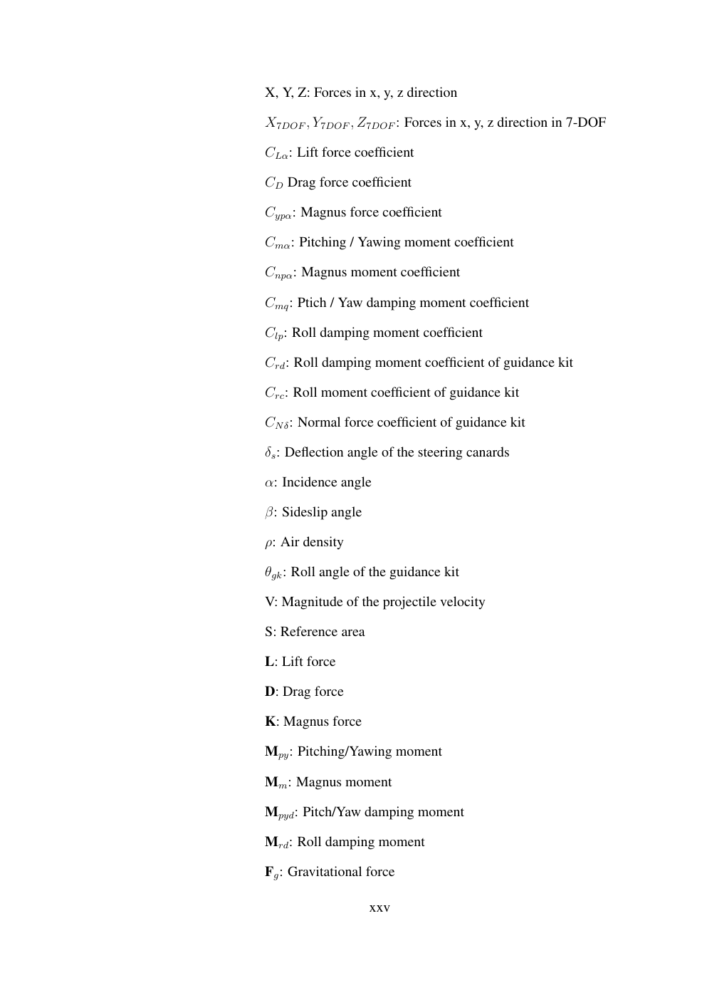

[Open page 025 as a PNG](visual_assets/page-025.png)

### PDF page 26 | thesis page xxvi
<!-- source: pdf_page=26; thesis_page=xxvi; section=Front matter -->
- **Section:** Front matter
- **Focus:** F: Total aerodynamic force for 6-DOF modeling

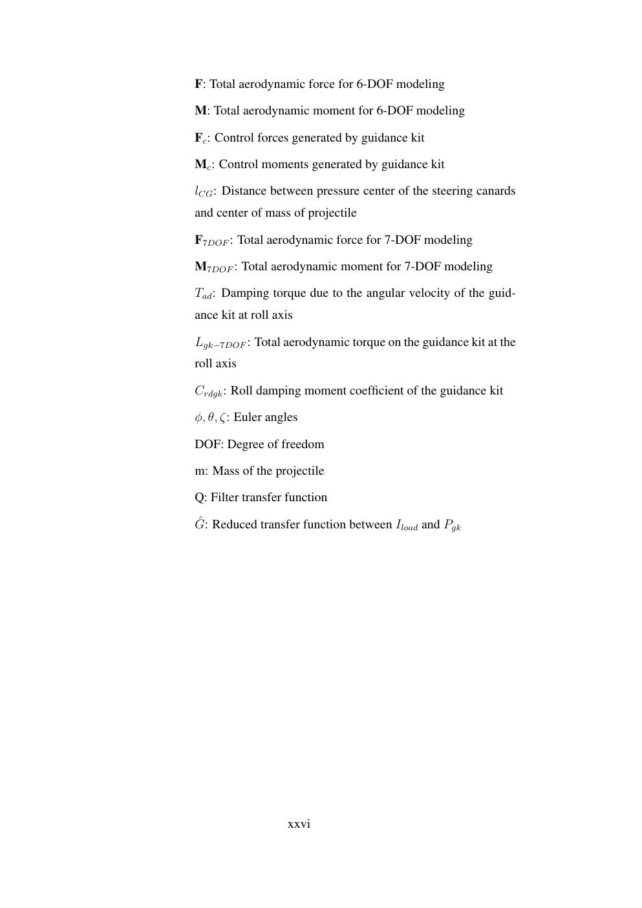

[Open page 026 as a PNG](visual_assets/page-026.png)

### PDF page 27 | thesis page 1
<!-- source: pdf_page=27; thesis_page=1; section=Chapter 1 - Introduction -->
- **Section:** Chapter 1 - Introduction
- **Focus:** CHAPTER 1 1.1 Motivation and Problem Definition

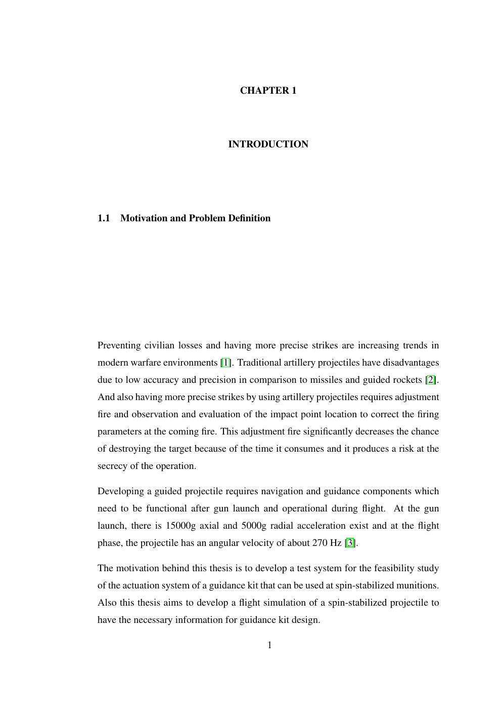

[Open page 027 as a PNG](visual_assets/page-027.png)

### PDF page 28 | thesis page 2
<!-- source: pdf_page=28; thesis_page=2; section=Chapter 1 - Introduction -->
- **Section:** Chapter 1 - Introduction
- **Focus:** Figure 1.1: An Example Design of 1-D Control Approach by Using Drag Brake In the existing works, there are two commonly used approaches to convert existing

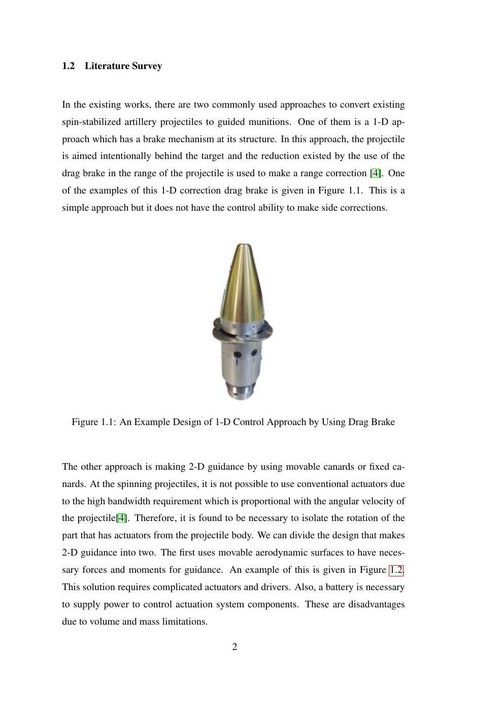

[Open page 028 as a PNG](visual_assets/page-028.png)

### PDF page 29 | thesis page 3
<!-- source: pdf_page=29; thesis_page=3; section=Chapter 1 - Introduction -->
- **Section:** Chapter 1 - Introduction
- **Focus:** Figure 1.2: An Example Design Which Uses Movable Aerodynamic Surfaces There is also an interesting approach that uses fixed aerodynamic surfaces isolated

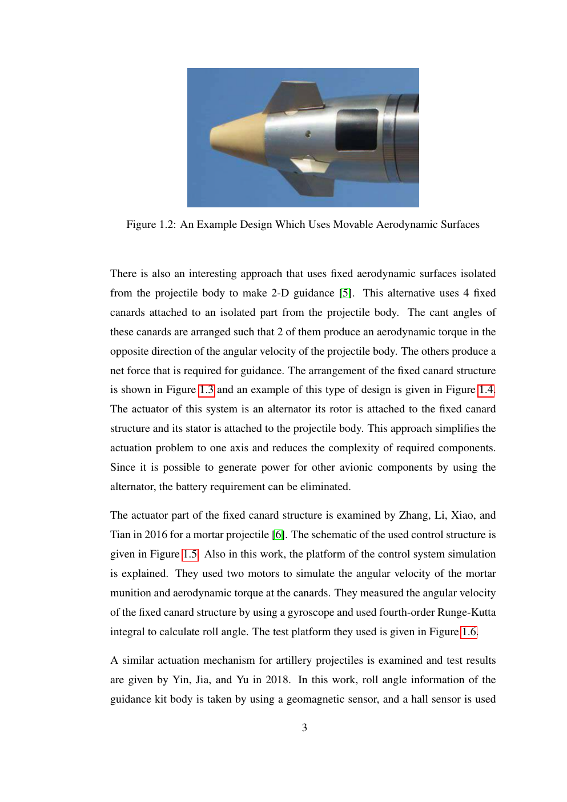

[Open page 029 as a PNG](visual_assets/page-029.png)

### PDF page 30 | thesis page 4
<!-- source: pdf_page=30; thesis_page=4; section=Chapter 1 - Introduction -->
- **Section:** Chapter 1 - Introduction
- **Focus:** Figure 1.3: Orientation of Fixed Canard Structure Figure 1.4: An Example Design Which Uses Fixed Aerodynamic Surfaces to get the position of the fixed-wing structure with respect to the projectile body [7.

[Open page 030 as a PNG](visual_assets/page-030.png)

### PDF page 31 | thesis page 5
<!-- source: pdf_page=31; thesis_page=5; section=Chapter 1 - Introduction -->
- **Section:** Chapter 1 - Introduction
- **Focus:** Figure 1.5: Schematics of Zhang, Li, Xiao and Tian’s Control Structure Figure 1.7: Yin, Jia and Yu’s Control Structure Flight dynamics of a projectile which has an isolated part from body rotation of the

[Open page 031 as a PNG](visual_assets/page-031.png)

### PDF page 32 | thesis page 6
<!-- source: pdf_page=32; thesis_page=6; section=Chapter 1 - Introduction -->
- **Section:** Chapter 1 - Introduction
- **Focus:** Figure 1.6: Zhang, Li, Xiao and Tian’s Test Set-up Figure 1.8: Costello’s Projectile Schematic forward body and aft body can rotate relatively.

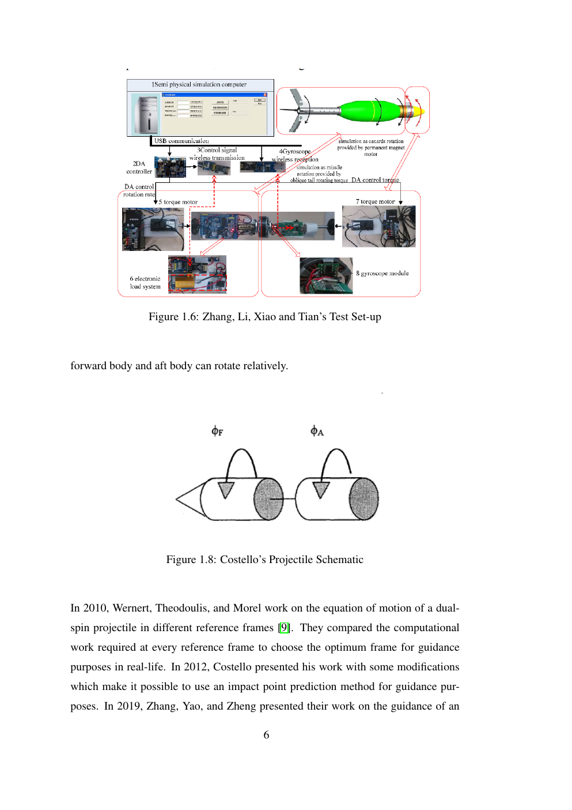

[Open page 032 as a PNG](visual_assets/page-032.png)

### PDF page 33 | thesis page 7
<!-- source: pdf_page=33; thesis_page=7; section=Chapter 1 - Introduction -->
- **Section:** Chapter 1 - Introduction
- **Focus:** artillery projectile by using fixed canards [10.

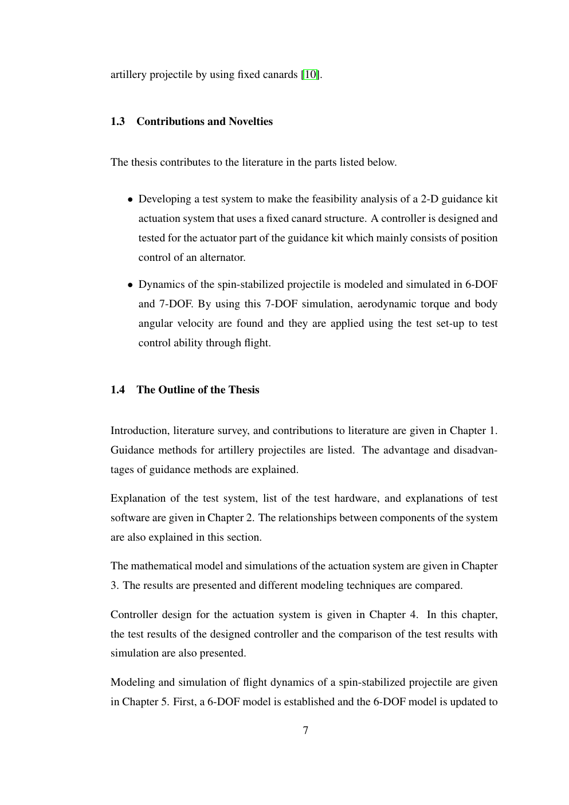

[Open page 033 as a PNG](visual_assets/page-033.png)

### PDF page 34 | thesis page 8
<!-- source: pdf_page=34; thesis_page=8; section=Chapter 1 - Introduction -->
- **Section:** Chapter 1 - Introduction
- **Focus:** 7-DOF to include the additional degree of freedom.

[Open page 034 as a PNG](visual_assets/page-034.png)

### PDF page 35 | thesis page 9
<!-- source: pdf_page=35; thesis_page=9; section=Chapter 2 - Test system -->
- **Section:** Chapter 2 - Test system
- **Focus:** CHAPTER 2 Table 2.1: Axial and Angular Velocities of 155 mm Spin-Stabilized Projectile 2.1 Explanation of System Aim to be Tested

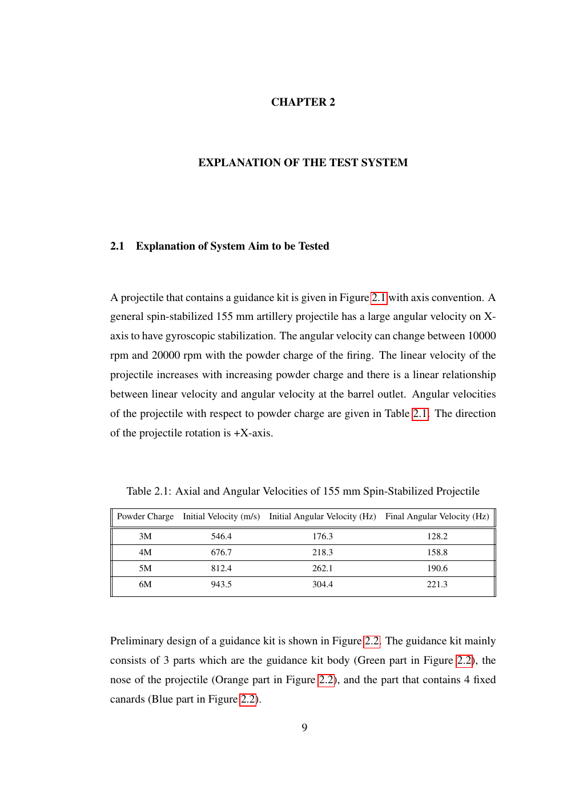

[Open page 035 as a PNG](visual_assets/page-035.png)

### PDF page 36 | thesis page 10
<!-- source: pdf_page=36; thesis_page=10; section=Chapter 2 - Test system -->
- **Section:** Chapter 2 - Test system
- **Focus:** Figure 2.1: An Example Projectile with Guidance Kit Figure 2.2: Preliminary Design of Guidance Kit Section view of Figure 2.2 is given in Figure 2.3. Guidance kit body and nose fixed

[Open page 036 as a PNG](visual_assets/page-036.png)

### PDF page 37 | thesis page 11
<!-- source: pdf_page=37; thesis_page=11; section=Chapter 2 - Test system -->
- **Section:** Chapter 2 - Test system
- **Focus:** Figure 2.3: Section View of Preliminary Design of an Example Guidance Kit green part. Since there is no stationary part in the system, it is not possible to use

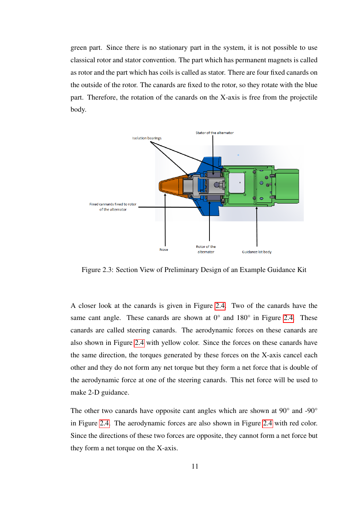

[Open page 037 as a PNG](visual_assets/page-037.png)

### PDF page 38 | thesis page 12
<!-- source: pdf_page=38; thesis_page=12; section=Chapter 2 - Test system -->
- **Section:** Chapter 2 - Test system
- **Focus:** Figure 2.4: Steering and Control Canards and Axis System The meanings of the symbols in Figure 2.4 are given below.

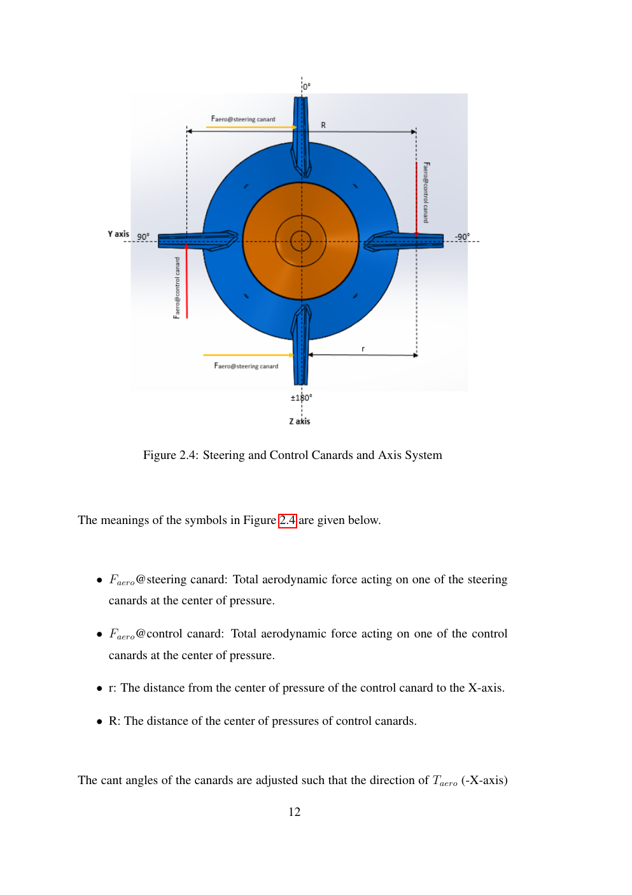

[Open page 038 as a PNG](visual_assets/page-038.png)

### PDF page 39 | thesis page 13
<!-- source: pdf_page=39; thesis_page=13; section=Chapter 2 - Test system -->
- **Section:** Chapter 2 - Test system
- **Focus:** Figure 2.5. Figure 2.5: Torques at Fixed Canard Structure and the rotation of the projectile body (+X-axis) are opposite to each other. Therefore,

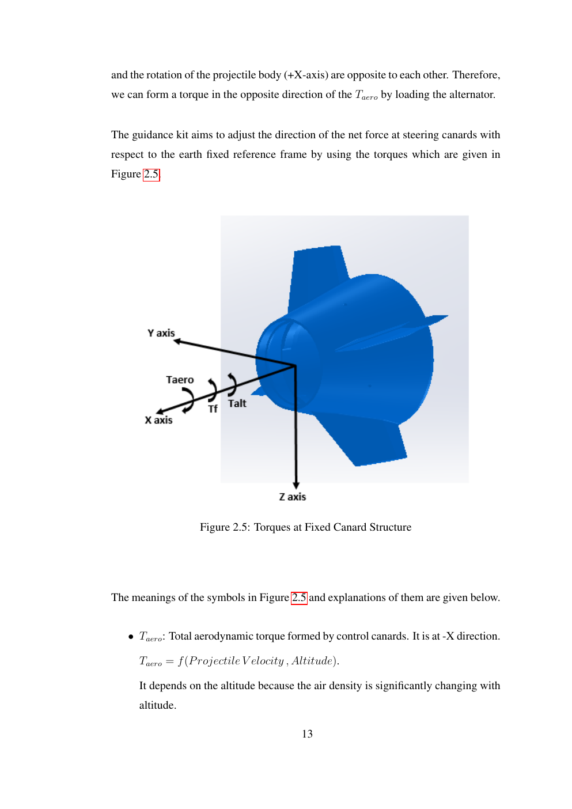

[Open page 039 as a PNG](visual_assets/page-039.png)

### PDF page 40 | thesis page 14
<!-- source: pdf_page=40; thesis_page=14; section=Chapter 2 - Test system -->
- **Section:** Chapter 2 - Test system
- **Focus:** Figure 2.9. • Tf: Friction torque at the bearings. It is in the same direction with projectile

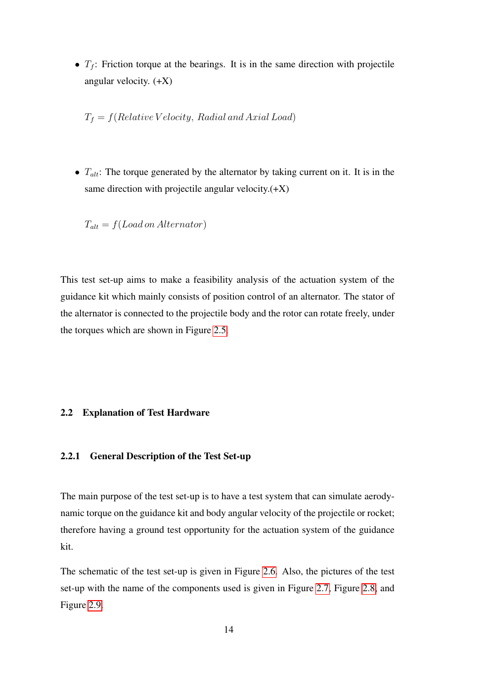

[Open page 040 as a PNG](visual_assets/page-040.png)

### PDF page 41 | thesis page 15
<!-- source: pdf_page=41; thesis_page=15; section=Chapter 2 - Test system -->
- **Section:** Chapter 2 - Test system
- **Focus:** Figure 2.6: Schematic of the Test Set-up Figure 2.7: General View of Test Set-up

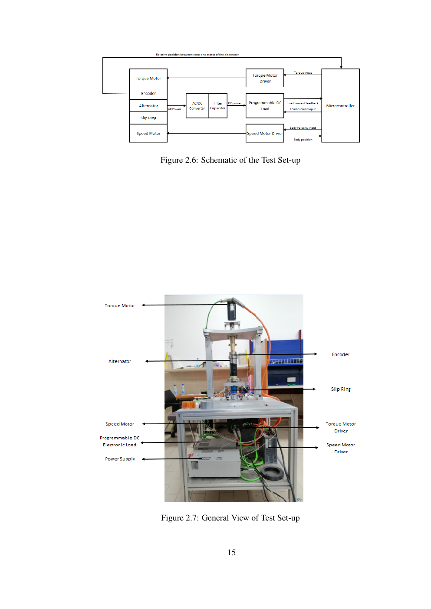

[Open page 041 as a PNG](visual_assets/page-041.png)

### PDF page 42 | thesis page 16
<!-- source: pdf_page=42; thesis_page=16; section=Chapter 2 - Test system -->
- **Section:** Chapter 2 - Test system
- **Focus:** Figure 2.8: Micro-controller Part Figure 2.9: AC/DC Converter and Filter Capacitor This set-up simulates aerodynamic torque on the guidance kit with a BLDC motor

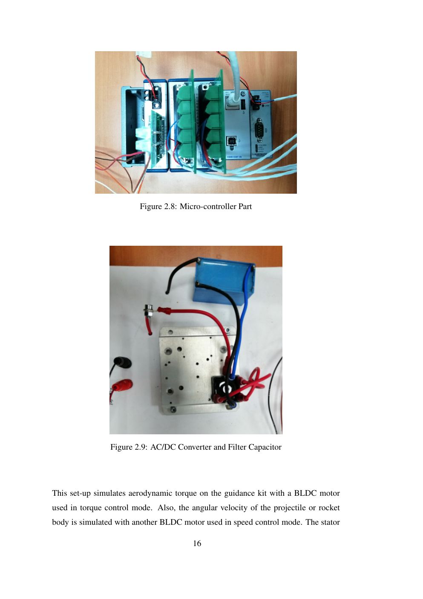

[Open page 042 as a PNG](visual_assets/page-042.png)

### PDF page 43 | thesis page 17
<!-- source: pdf_page=43; thesis_page=17; section=Chapter 2 - Test system -->
- **Section:** Chapter 2 - Test system
- **Focus:** Table 2.2: Mechanical Parts of the Actuator Part of Test Set-up of the alternator is fixed to the part that rotates with the speed motor. There is an

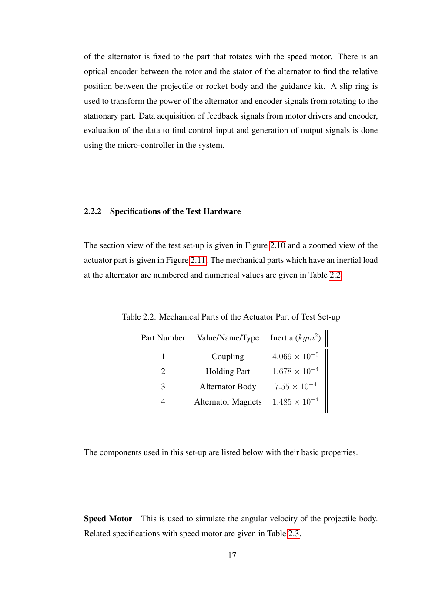

[Open page 043 as a PNG](visual_assets/page-043.png)

### PDF page 44 | thesis page 18
<!-- source: pdf_page=44; thesis_page=18; section=Chapter 2 - Test system -->
- **Section:** Chapter 2 - Test system
- **Focus:** Figure 2.10: Section View of the Test Set-up Table 2.3: Speed Motor Specifications

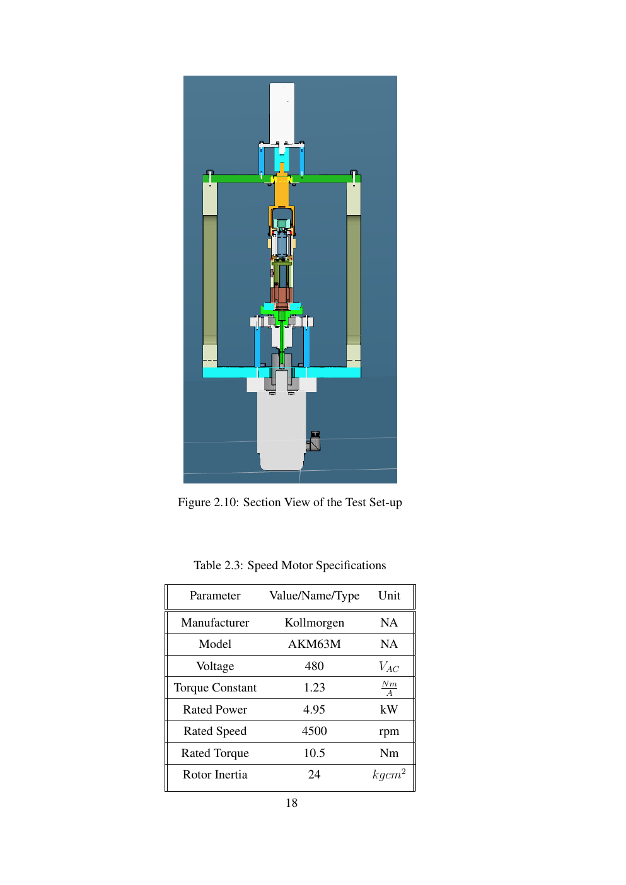

[Open page 044 as a PNG](visual_assets/page-044.png)

### PDF page 45 | thesis page 19
<!-- source: pdf_page=45; thesis_page=19; section=Chapter 2 - Test system -->
- **Section:** Chapter 2 - Test system
- **Focus:** Figure 2.11: Zoomed View of Actuator Part Table 2.4: Torque Motor Specifications Torque Motor This is used to simulate the aerodynamic torque at the system. Related specifications with torque motor are given in Table 2.4.

[Open page 045 as a PNG](visual_assets/page-045.png)

### PDF page 46 | thesis page 20
<!-- source: pdf_page=46; thesis_page=20; section=Chapter 2 - Test system -->
- **Section:** Chapter 2 - Test system
- **Focus:** Table 2.5: Speed Motor Driver Specifications Table 2.6: Torque Motor Driver Specifications Speed Motor Driver This component is used to control the speed motor. Related

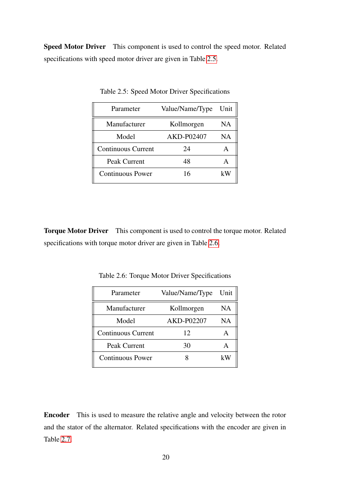

[Open page 046 as a PNG](visual_assets/page-046.png)

### PDF page 47 | thesis page 21
<!-- source: pdf_page=47; thesis_page=21; section=Chapter 2 - Test system -->
- **Section:** Chapter 2 - Test system
- **Focus:** Table 2.7: Encoder Specifications Table 2.8: Alternator Specifications Encoder Type Incremental with index NA

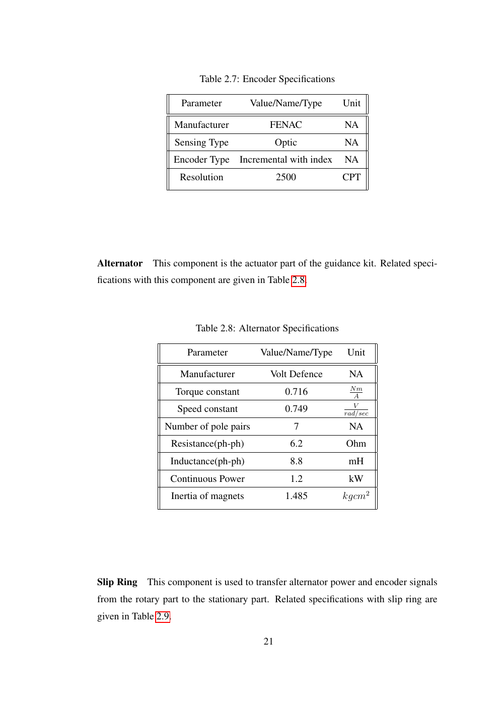

[Open page 047 as a PNG](visual_assets/page-047.png)

### PDF page 48 | thesis page 22
<!-- source: pdf_page=48; thesis_page=22; section=Chapter 2 - Test system -->
- **Section:** Chapter 2 - Test system
- **Focus:** Table 2.9: Slip Ring Specifications Table 2.10. Filter Capacitor This component is used to filter transient components of voltage

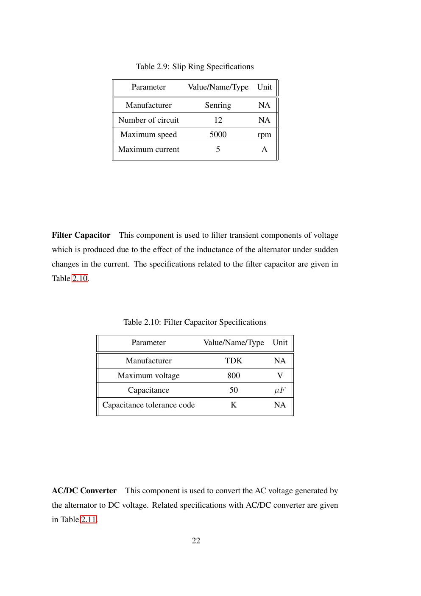

[Open page 048 as a PNG](visual_assets/page-048.png)

### PDF page 49 | thesis page 23
<!-- source: pdf_page=49; thesis_page=23; section=Chapter 2 - Test system -->
- **Section:** Chapter 2 - Test system
- **Focus:** Table 2.11: AC/DC Converter Specifications Table 2.12: Power Supply Specifications Maximum continuous DC current 25 A

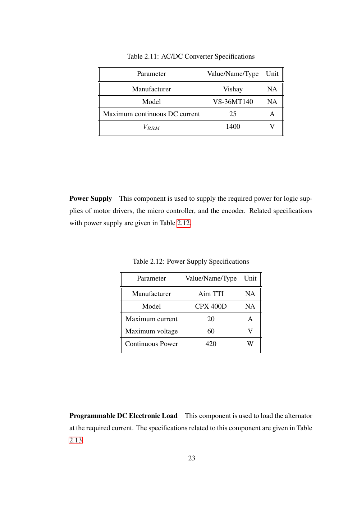

[Open page 049 as a PNG](visual_assets/page-049.png)

### PDF page 50 | thesis page 24
<!-- source: pdf_page=50; thesis_page=24; section=Chapter 2 - Test system -->
- **Section:** Chapter 2 - Test system
- **Focus:** Table 2.13: Programmable DC Electronic Load Specifications Table 2.14: Micro-controller Components Micro-controller Components These components are used for data acquisition

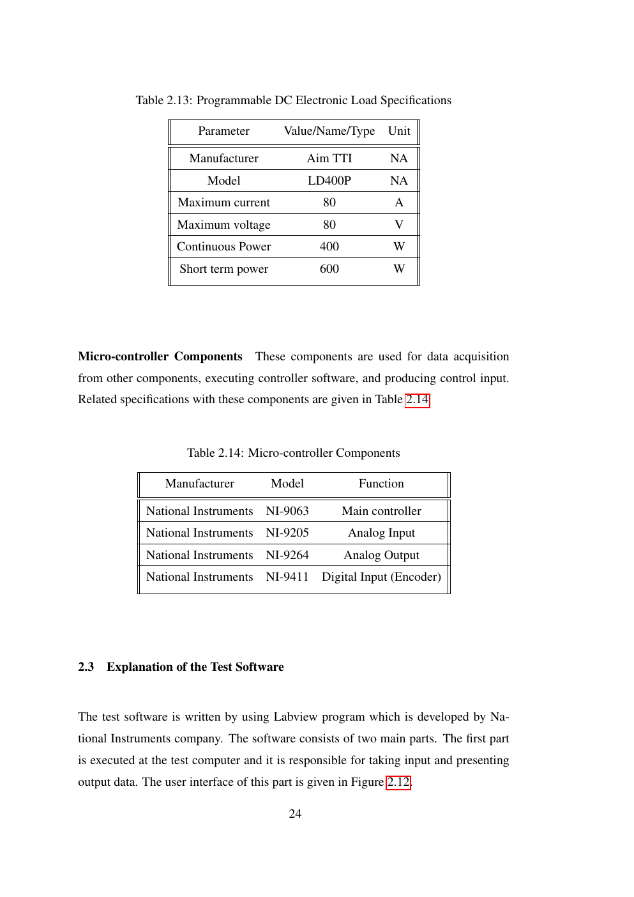

[Open page 050 as a PNG](visual_assets/page-050.png)

### PDF page 51 | thesis page 25
<!-- source: pdf_page=51; thesis_page=25; section=Chapter 2 - Test system -->
- **Section:** Chapter 2 - Test system
- **Focus:** Figure 2.12: User Interface of the Test Software Figure 2.13. The second part is programmed by using FPGA target of the NI-9063 to have fast and

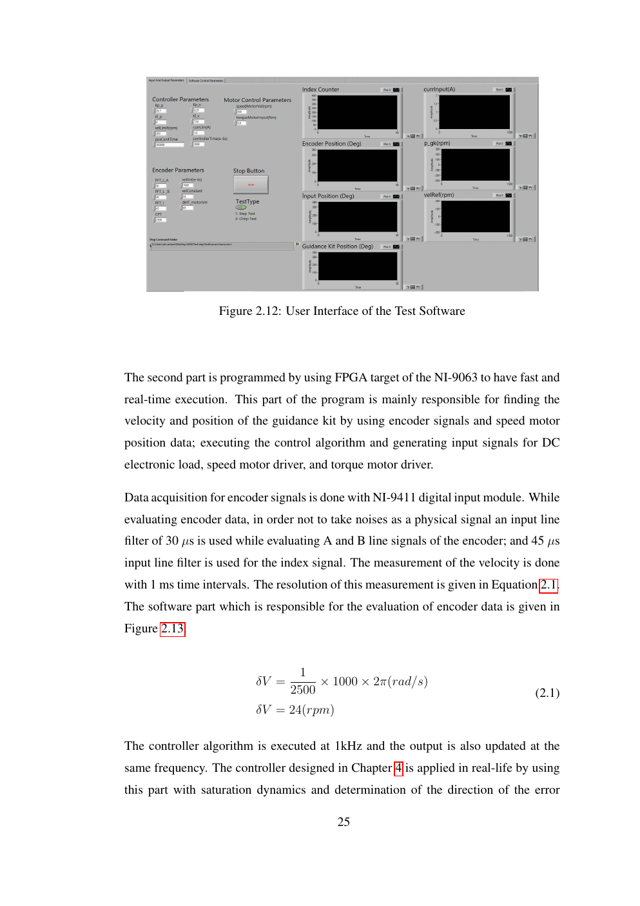

[Open page 051 as a PNG](visual_assets/page-051.png)

### PDF page 52 | thesis page 26
<!-- source: pdf_page=52; thesis_page=26; section=Chapter 2 - Test system -->
- **Section:** Chapter 2 - Test system
- **Focus:** Figure 2.13: Encoder Evaluation Part of the Test Software to apply minimum control effort. The software part which is responsible for the

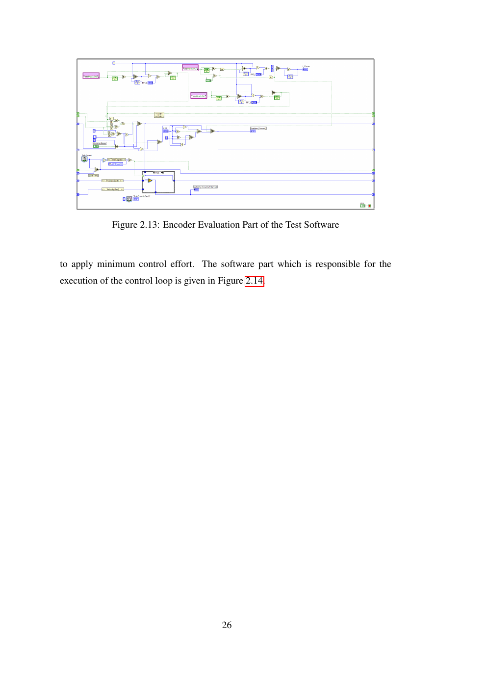

[Open page 052 as a PNG](visual_assets/page-052.png)

### PDF page 53 | thesis page 27
<!-- source: pdf_page=53; thesis_page=27; section=Chapter 2 - Test system -->
- **Section:** Chapter 2 - Test system
- **Focus:** Figure 2.14: Controller Part of the Test Software

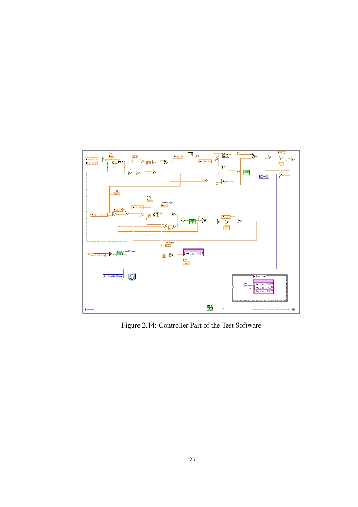

[Open page 053 as a PNG](visual_assets/page-053.png)

### PDF page 54 | thesis page 28
<!-- source: pdf_page=54; thesis_page=28; section=Chapter 2 - Test system -->
- **Section:** Chapter 2 - Test system
- **Focus:** Blank page.

[Open page 054 as a PNG](visual_assets/page-054.png)

### PDF page 55 | thesis page 29
<!-- source: pdf_page=55; thesis_page=29; section=Chapter 3 - Test-system model -->
- **Section:** Chapter 3 - Test-system model
- **Focus:** CHAPTER 3 Figure 3.1: Physical Model of Test Set-up MATHEMATICAL MODEL OF THE TEST SYSTEM

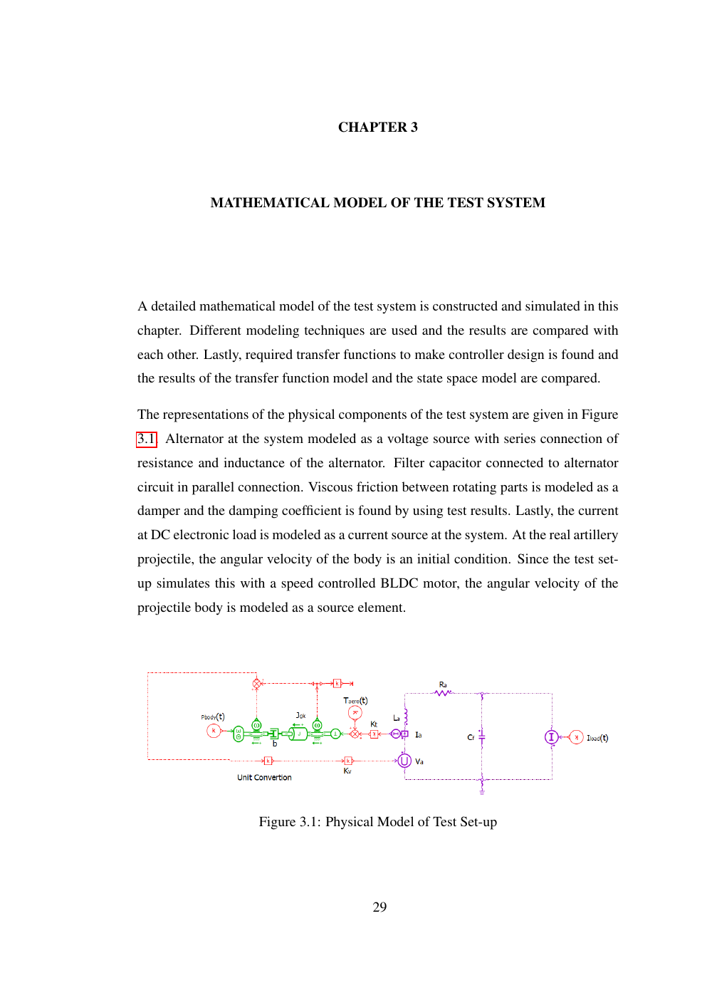

[Open page 055 as a PNG](visual_assets/page-055.png)

### PDF page 56 | thesis page 30
<!-- source: pdf_page=56; thesis_page=30; section=Chapter 3 - Test-system model -->
- **Section:** Chapter 3 - Test-system model
- **Focus:** Figure 3.2: Linear Graph Model of Test Set-up The Linear Graph Method is used to find the system model systematically. The linear

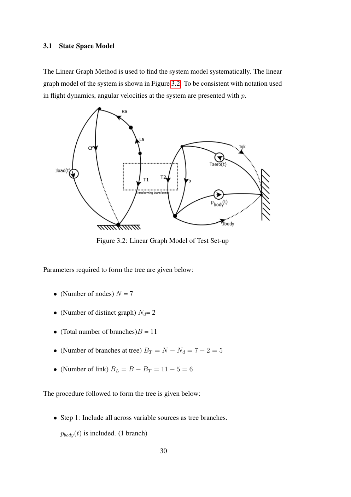

[Open page 056 as a PNG](visual_assets/page-056.png)

### PDF page 57 | thesis page 31
<!-- source: pdf_page=57; thesis_page=31; section=Chapter 3 - Test-system model -->
- **Section:** Chapter 3 - Test-system model
- **Focus:** Figure 3.3: System Tree of the Linear Graph Model • Step 2: Include as many as A-type elements with one branch of the transformer.

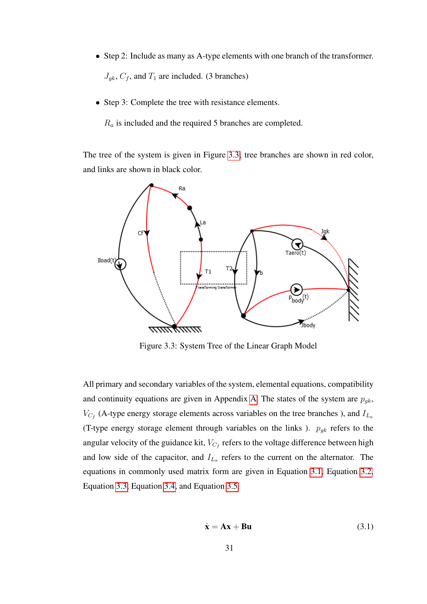

[Open page 057 as a PNG](visual_assets/page-057.png)

### PDF page 58 | thesis page 32
<!-- source: pdf_page=58; thesis_page=32; section=Chapter 3 - Test-system model -->
- **Section:** Chapter 3 - Test-system model
- **Focus:** The state space model of the system is simulated with Matlab/Simulink environment

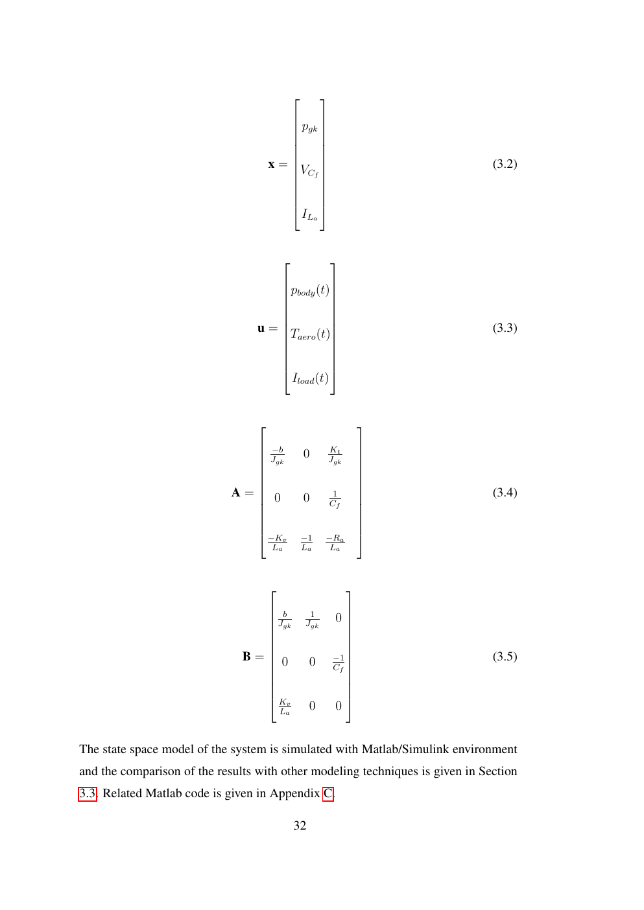

[Open page 058 as a PNG](visual_assets/page-058.png)

### PDF page 59 | thesis page 33
<!-- source: pdf_page=59; thesis_page=33; section=Chapter 3 - Test-system model -->
- **Section:** Chapter 3 - Test-system model
- **Focus:** Figure 3.4: Block Diagram of Simulink Model To be sure of the mathematical model that is found by using the state space approach,

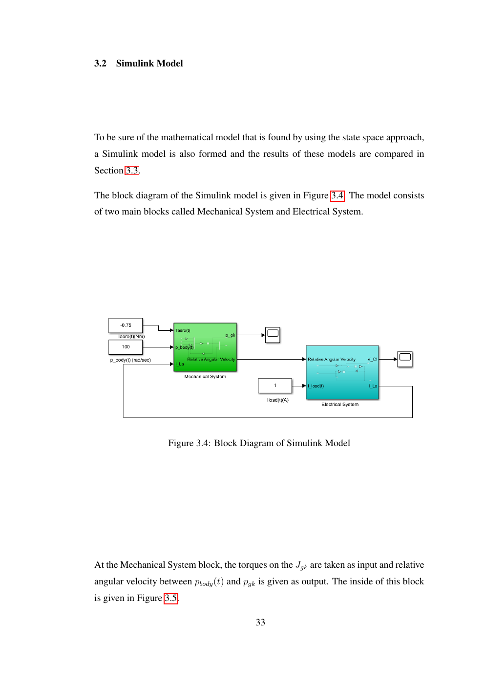

[Open page 059 as a PNG](visual_assets/page-059.png)

### PDF page 60 | thesis page 34
<!-- source: pdf_page=60; thesis_page=34; section=Chapter 3 - Test-system model -->
- **Section:** Chapter 3 - Test-system model
- **Focus:** Figure 3.5: Inside of Mechanical System Block Figure 3.6: Inside of Electrical System Block At the Electrical System block, relative velocity and Iload(t) are taken as inputs and

[Open page 060 as a PNG](visual_assets/page-060.png)

### PDF page 61 | thesis page 35
<!-- source: pdf_page=61; thesis_page=35; section=Chapter 3 - Test-system model -->
- **Section:** Chapter 3 - Test-system model
- **Focus:** Figure 3.7: The Differences of State Variables Between State Space and Simulink The differences between the state variables are given in Figure 3.7. As it is expected,

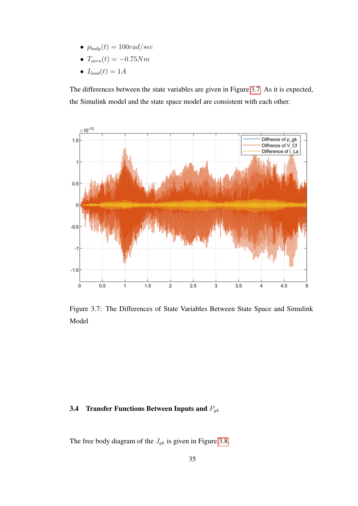

[Open page 061 as a PNG](visual_assets/page-061.png)

### PDF page 62 | thesis page 36
<!-- source: pdf_page=62; thesis_page=36; section=Chapter 3 - Test-system model -->
- **Section:** Chapter 3 - Test-system model
- **Focus:** Figure 3.8: Free Body Diagram ofJgk The torques at theJgk are explained in the list below:

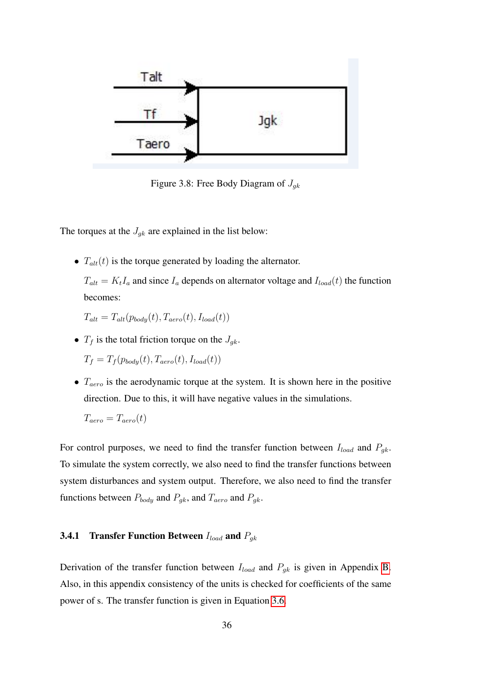

[Open page 062 as a PNG](visual_assets/page-062.png)

### PDF page 63 | thesis page 37
<!-- source: pdf_page=63; thesis_page=37; section=Chapter 3 - Test-system model -->
- **Section:** Chapter 3 - Test-system model
- **Focus:** 3.4.2 Transfer Function Between Taero andPgk

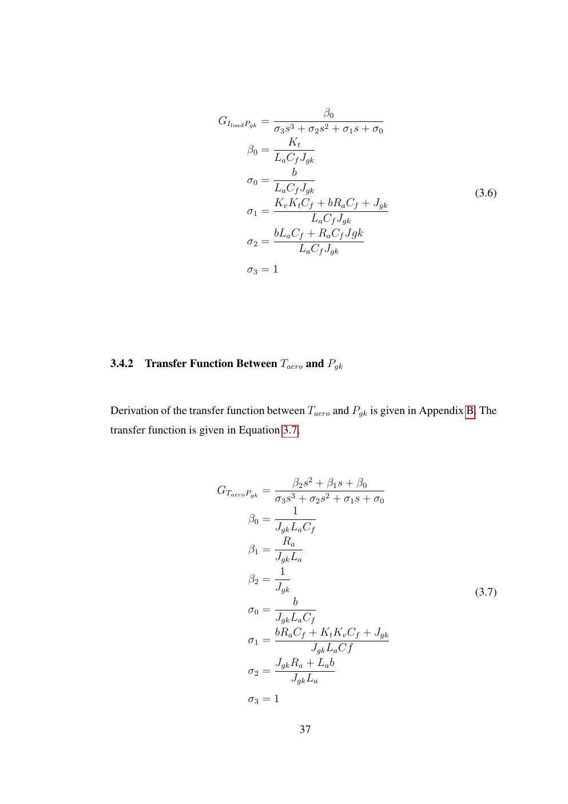

[Open page 063 as a PNG](visual_assets/page-063.png)

### PDF page 64 | thesis page 38
<!-- source: pdf_page=64; thesis_page=38; section=Chapter 3 - Test-system model -->
- **Section:** Chapter 3 - Test-system model
- **Focus:** 3.4.3 Transfer Function Between Pbody andPgk

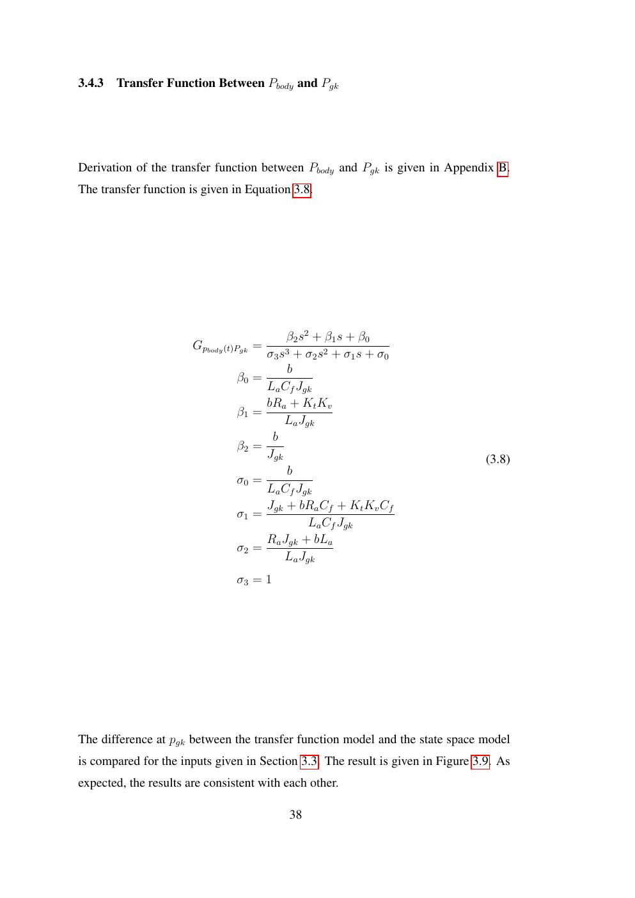

[Open page 064 as a PNG](visual_assets/page-064.png)

### PDF page 65 | thesis page 39
<!-- source: pdf_page=65; thesis_page=39; section=Chapter 3 - Test-system model -->
- **Section:** Chapter 3 - Test-system model
- **Focus:** Figure 3.9: Comparison Between Transfer Function Models and State Space Results 3.5 Comparison of the Model Results and Test Results

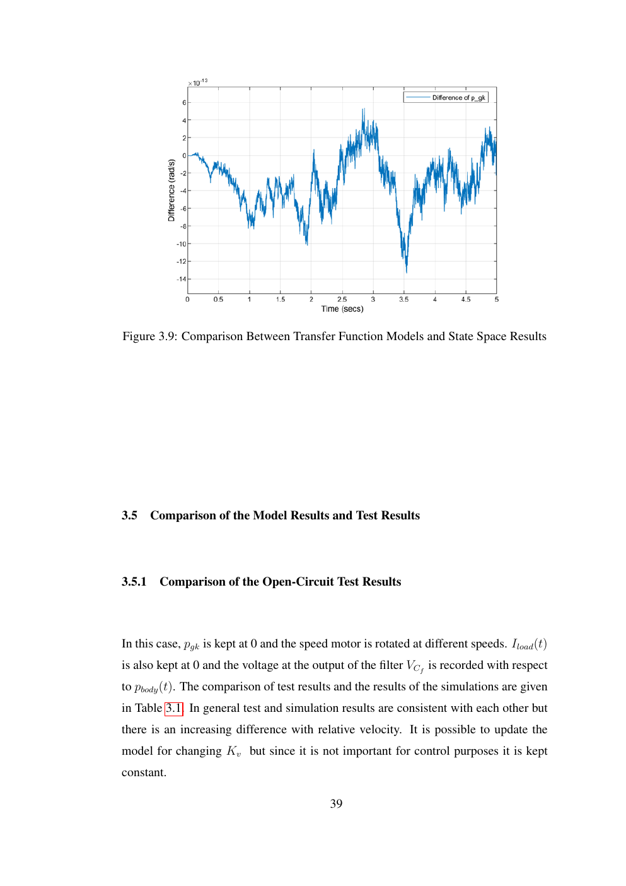

[Open page 065 as a PNG](visual_assets/page-065.png)

### PDF page 66 | thesis page 40
<!-- source: pdf_page=66; thesis_page=40; section=Chapter 3 - Test-system model -->
- **Section:** Chapter 3 - Test-system model
- **Focus:** Table 3.1: Open-Circuit Test Results (rad/s) Test Result (V) Simulation Result (V) Test Result (rad/s

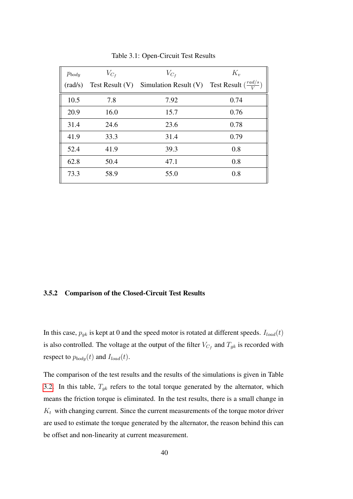

[Open page 066 as a PNG](visual_assets/page-066.png)

### PDF page 67 | thesis page 41
<!-- source: pdf_page=67; thesis_page=41; section=Chapter 3 - Test-system model -->
- **Section:** Chapter 3 - Test-system model
- **Focus:** Table 3.2: Closed-Circuit Test Results (rad/s) Test Result(V) Simulation Result(V) (Nm) Test Result(A) (N/m

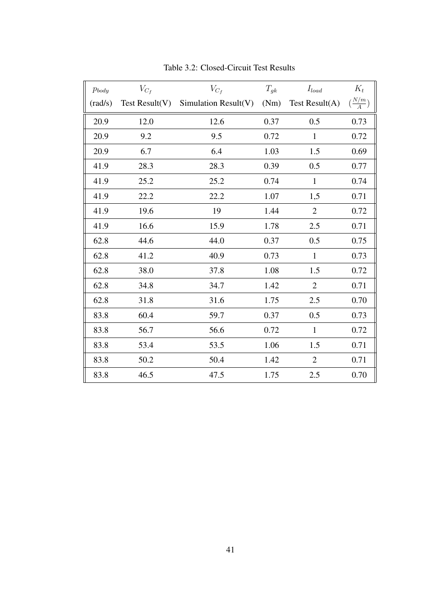

[Open page 067 as a PNG](visual_assets/page-067.png)

### PDF page 68 | thesis page 42
<!-- source: pdf_page=68; thesis_page=42; section=Chapter 3 - Test-system model -->
- **Section:** Chapter 3 - Test-system model
- **Focus:** Blank page.

[Open page 068 as a PNG](visual_assets/page-068.png)

### PDF page 69 | thesis page 43
<!-- source: pdf_page=69; thesis_page=43; section=Chapter 4 - Controller design -->
- **Section:** Chapter 4 - Controller design
- **Focus:** CHAPTER 4 There are many controller types used in servo control and other control problems.

[Open page 069 as a PNG](visual_assets/page-069.png)

### PDF page 70 | thesis page 44
<!-- source: pdf_page=70; thesis_page=44; section=Chapter 4 - Controller design -->
- **Section:** Chapter 4 - Controller design
- **Focus:** Figure 4.1: Cascade Control Structure noise, derivative action will be the last choice in the controller design.

[Open page 070 as a PNG](visual_assets/page-070.png)

### PDF page 71 | thesis page 45
<!-- source: pdf_page=71; thesis_page=45; section=Chapter 4 - Controller design -->
- **Section:** Chapter 4 - Controller design
- **Focus:** Table 4.1: Requirements of the Position Controller Table 4.2: Requirements of the Velocity Controller dynamics in the reference position is required when the projectile is on the required

[Open page 071 as a PNG](visual_assets/page-071.png)

### PDF page 72 | thesis page 46
<!-- source: pdf_page=72; thesis_page=46; section=Chapter 4 - Controller design -->
- **Section:** Chapter 4 - Controller design
- **Focus:** input R(s) and output C(s) is given in Equation 4.3. The dynamics of a second-order

[Open page 072 as a PNG](visual_assets/page-072.png)

### PDF page 73 | thesis page 47
<!-- source: pdf_page=73; thesis_page=47; section=Chapter 4 - Controller design -->
- **Section:** Chapter 4 - Controller design
- **Focus:** Static position error constant is found in Equation 4.8 by using the Final Value Theorem and replacing the Laplace transform of the unit step function, 1

[Open page 073 as a PNG](visual_assets/page-073.png)

### PDF page 74 | thesis page 48
<!-- source: pdf_page=74; thesis_page=48; section=Chapter 4 - Controller design -->
- **Section:** Chapter 4 - Controller design
- **Focus:** Since reference input equated to zero, the error can be found by multiplying the transfer function found in Equation 4.11 with the disturbancePbody. Equation of error due

[Open page 074 as a PNG](visual_assets/page-074.png)

### PDF page 75 | thesis page 49
<!-- source: pdf_page=75; thesis_page=49; section=Chapter 4 - Controller design -->
- **Section:** Chapter 4 - Controller design
- **Focus:** Figure 4.2: Root Locus Graph ofGIloadPgk Root-Locus of the GIloadPgk is given in Figure 4.2. The transfer function has three

[Open page 075 as a PNG](visual_assets/page-075.png)

### PDF page 76 | thesis page 50
<!-- source: pdf_page=76; thesis_page=50; section=Chapter 4 - Controller design -->
- **Section:** Chapter 4 - Controller design
- **Focus:** Figure 4.3: Root Locus Graph of Compensated Velocity Loop zero should be added near the pole to compensate for the effect of the integrator,

[Open page 076 as a PNG](visual_assets/page-076.png)

### PDF page 77 | thesis page 51
<!-- source: pdf_page=77; thesis_page=51; section=Chapter 4 - Controller design -->
- **Section:** Chapter 4 - Controller design
- **Focus:** Figure 4.4: Step Response of Velocity Loop Figure 4.5: Bode Plot of Velocity Loop The step response of the designed controller is given in Figure 4.4 and Bode graph is

[Open page 077 as a PNG](visual_assets/page-077.png)

### PDF page 78 | thesis page 52
<!-- source: pdf_page=78; thesis_page=52; section=Chapter 4 - Controller design -->
- **Section:** Chapter 4 - Controller design
- **Focus:** Figure 4.6: Error Due to Step Disturbance atTaero Also, we need to check the behavior of the controller to system disturbances. The

[Open page 078 as a PNG](visual_assets/page-078.png)

### PDF page 79 | thesis page 53
<!-- source: pdf_page=79; thesis_page=53; section=Chapter 4 - Controller design -->
- **Section:** Chapter 4 - Controller design
- **Focus:** Figure 4.7: Error Due to Step Disturbance atpbody Table 4.3: Result of Velocity Controller Design Parameter Requirement Result Unit

[Open page 079 as a PNG](visual_assets/page-079.png)

### PDF page 80 | thesis page 54
<!-- source: pdf_page=80; thesis_page=54; section=Chapter 4 - Controller design -->
- **Section:** Chapter 4 - Controller design
- **Focus:** Desired closed-loop pole locations of the position loop can be found by making

[Open page 080 as a PNG](visual_assets/page-080.png)

### PDF page 81 | thesis page 55
<!-- source: pdf_page=81; thesis_page=55; section=Chapter 4 - Controller design -->
- **Section:** Chapter 4 - Controller design
- **Focus:** Figure 4.8: Root Locus Graph ofGolp Locations of the open-loop poles are listed below.

[Open page 081 as a PNG](visual_assets/page-081.png)

### PDF page 82 | thesis page 56
<!-- source: pdf_page=82; thesis_page=56; section=Chapter 4 - Controller design -->
- **Section:** Chapter 4 - Controller design
- **Focus:** Figure 4.9: Step Response of Position Loop Table 4.4: Result of Position Controller Design The step response of the position loop is given in Figure 4.9 and the Bode plot of the

[Open page 082 as a PNG](visual_assets/page-082.png)

### PDF page 83 | thesis page 57
<!-- source: pdf_page=83; thesis_page=57; section=Chapter 4 - Controller design -->
- **Section:** Chapter 4 - Controller design
- **Focus:** Figure 4.10: Bode Plot of Position Loop Figure 4.11: Block Diagram of Simulation 4.4 Test Results and Comparison

[Open page 083 as a PNG](visual_assets/page-083.png)

### PDF page 84 | thesis page 58
<!-- source: pdf_page=84; thesis_page=58; section=Chapter 4 - Controller design -->
- **Section:** Chapter 4 - Controller design
- **Focus:** Figure 4.12: Velocity Controller Block Figure 4.13: Position Controller Block Inside of the velocity controller block is given in Figure 4.12. Clamping integration

[Open page 084 as a PNG](visual_assets/page-084.png)

### PDF page 85 | thesis page 59
<!-- source: pdf_page=85; thesis_page=59; section=Chapter 4 - Controller design -->
- **Section:** Chapter 4 - Controller design
- **Focus:** Figure 4.14: Inside of Calculate Minimum Control Effort Block Table 4.5: Test Conditions The inputs and saturation points in the test case are given in Table 4.5.

[Open page 085 as a PNG](visual_assets/page-085.png)

### PDF page 86 | thesis page 60
<!-- source: pdf_page=86; thesis_page=60; section=Chapter 4 - Controller design -->
- **Section:** Chapter 4 - Controller design
- **Focus:** Figure 4.15: Input, Simulation, and Test Results for Step Test Figure 4.16: Input, Simulation and Test Results for Step Test with Zoomed View Position controller outputs for test and simulation results are given in Figure 4.17 and

[Open page 086 as a PNG](visual_assets/page-086.png)

### PDF page 87 | thesis page 61
<!-- source: pdf_page=87; thesis_page=61; section=Chapter 4 - Controller design -->
- **Section:** Chapter 4 - Controller design
- **Focus:** Figure 4.17: Output of Position Controller at Step Test Figure 4.18: Output of Position Controller at Step Test with Zoomed View

[Open page 087 as a PNG](visual_assets/page-087.png)

### PDF page 88 | thesis page 62
<!-- source: pdf_page=88; thesis_page=62; section=Chapter 4 - Controller design -->
- **Section:** Chapter 4 - Controller design
- **Focus:** Figure 4.19:pgk at Simulation and Test Results pgk at simulation and test results are given in Figure 4.19 and zoomed view of this

[Open page 088 as a PNG](visual_assets/page-088.png)

### PDF page 89 | thesis page 63
<!-- source: pdf_page=89; thesis_page=63; section=Chapter 4 - Controller design -->
- **Section:** Chapter 4 - Controller design
- **Focus:** Figure 4.20:pgk at Simulation and Test Results with Zoomed View Figure 4.21: Input, Simulation, and Test Results for Chip Test

[Open page 089 as a PNG](visual_assets/page-089.png)

### PDF page 90 | thesis page 64
<!-- source: pdf_page=90; thesis_page=64; section=Chapter 4 - Controller design -->
- **Section:** Chapter 4 - Controller design
- **Focus:** Figure 4.22: Input, Simulation, and Test Results for Chip Test with Zoomed View The output of the position controller is compared in Figure 4.23. Also, feedback

[Open page 090 as a PNG](visual_assets/page-090.png)

### PDF page 91 | thesis page 65
<!-- source: pdf_page=91; thesis_page=65; section=Chapter 4 - Controller design -->
- **Section:** Chapter 4 - Controller design
- **Focus:** Figure 4.23: Output of the Position Controller Results for Chip Test

[Open page 091 as a PNG](visual_assets/page-091.png)

### PDF page 92 | thesis page 66
<!-- source: pdf_page=92; thesis_page=66; section=Chapter 4 - Controller design -->
- **Section:** Chapter 4 - Controller design
- **Focus:** Figure 4.24:pgk at Simulation and Test Results

[Open page 092 as a PNG](visual_assets/page-092.png)

### PDF page 93 | thesis page 67
<!-- source: pdf_page=93; thesis_page=67; section=Chapter 5 - Flight dynamics -->
- **Section:** Chapter 5 - Flight dynamics
- **Focus:** CHAPTER 5 Figure 5.1: Torques on the Guidance Kit FLIGHT DYNAMICS OF THE ARTILLERY PROJECTILE

[Open page 093 as a PNG](visual_assets/page-093.png)

### PDF page 94 | thesis page 68
<!-- source: pdf_page=94; thesis_page=68; section=Chapter 5 - Flight dynamics -->
- **Section:** Chapter 5 - Flight dynamics
- **Focus:** The torques at the +X and -X directions are given in Equation 5.1 and Equation 5.2.

[Open page 094 as a PNG](visual_assets/page-094.png)

### PDF page 95 | thesis page 69
<!-- source: pdf_page=95; thesis_page=69; section=Chapter 5 - Flight dynamics -->
- **Section:** Chapter 5 - Flight dynamics
- **Focus:** Figure 5.2: Flat Earth Inertial Reference Frame times. Therefore defining a middle coordinate system that has no rolling motion is

[Open page 095 as a PNG](visual_assets/page-095.png)

### PDF page 96 | thesis page 70
<!-- source: pdf_page=96; thesis_page=70; section=Chapter 5 - Flight dynamics -->
- **Section:** Chapter 5 - Flight dynamics
- **Focus:** 5.1.2 Body Fixed Plane Coordinate System

[Open page 096 as a PNG](visual_assets/page-096.png)

### PDF page 97 | thesis page 71
<!-- source: pdf_page=97; thesis_page=71; section=Chapter 5 - Flight dynamics -->
- **Section:** Chapter 5 - Flight dynamics
- **Focus:** 5.2 Mathematical Model and Simulation of 6-DOF Projectile Dynamics

[Open page 097 as a PNG](visual_assets/page-097.png)

### PDF page 98 | thesis page 72
<!-- source: pdf_page=98; thesis_page=72; section=Chapter 5 - Flight dynamics -->
- **Section:** Chapter 5 - Flight dynamics
- **Focus:** The equations which represent the kinematics of the system are given in Equation 5.9

[Open page 098 as a PNG](visual_assets/page-098.png)

### PDF page 99 | thesis page 73
<!-- source: pdf_page=99; thesis_page=73; section=Chapter 5 - Flight dynamics -->
- **Section:** Chapter 5 - Flight dynamics
- **Focus:** Figure 5.3: Overall Structure of 6-DOF Simulation Table 5.1. The physical properties of the simulated projectile and initial conditions are given in

[Open page 099 as a PNG](visual_assets/page-099.png)

### PDF page 100 | thesis page 74
<!-- source: pdf_page=100; thesis_page=74; section=Chapter 5 - Flight dynamics -->
- **Section:** Chapter 5 - Flight dynamics
- **Focus:** Figure 5.4: Positions at Earth Fixed Reference Frame 5.3 Mathematical Model and Simulation of 7-DOF Projectile Dynamics

[Open page 100 as a PNG](visual_assets/page-100.png)

### PDF page 101 | thesis page 75
<!-- source: pdf_page=101; thesis_page=75; section=Chapter 5 - Flight dynamics -->
- **Section:** Chapter 5 - Flight dynamics
- **Focus:** Figure 5.5: Velocities at Earth Fixed Reference Frame The inertia matrix in Equation 5.12, I, is given in Equation 5.14.

[Open page 101 as a PNG](visual_assets/page-101.png)

### PDF page 102 | thesis page 76
<!-- source: pdf_page=102; thesis_page=76; section=Chapter 5 - Flight dynamics -->
- **Section:** Chapter 5 - Flight dynamics
- **Focus:** Figure 5.6: Positions at Earth Fixed Reference Frame Since the kinematics of the system is not change with the addition of 1-DOF, it is

[Open page 102 as a PNG](visual_assets/page-102.png)

### PDF page 103 | thesis page 77
<!-- source: pdf_page=103; thesis_page=77; section=Chapter 5 - Flight dynamics -->
- **Section:** Chapter 5 - Flight dynamics
- **Focus:** Figure 5.7: Velocities at Earth Fixed Reference Frame Figure 5.8: Control Forces at Body Fixed Plane Reference Frame The control forces and moments that arise from the addition of the guidance kit are

[Open page 103 as a PNG](visual_assets/page-103.png)

### PDF page 104 | thesis page 78
<!-- source: pdf_page=104; thesis_page=78; section=Chapter 5 - Flight dynamics -->
- **Section:** Chapter 5 - Flight dynamics
- **Focus:** Figure 5.9: Control Moments at Body Fixed Plane Reference Frame Aerodynamic torqueTaero and aerodynamic damping torque Tad on the guidance kit

[Open page 104 as a PNG](visual_assets/page-104.png)

### PDF page 105 | thesis page 79
<!-- source: pdf_page=105; thesis_page=79; section=Chapter 5 - Flight dynamics -->
- **Section:** Chapter 5 - Flight dynamics
- **Focus:** Figure 5.10: Aerodynamic TorqueTaero on Guidance Kit Figure 5.11: Aerodynamic Damping TorqueTad on Guidance Kit

[Open page 105 as a PNG](visual_assets/page-105.png)

### PDF page 106 | thesis page 80
<!-- source: pdf_page=106; thesis_page=80; section=Chapter 5 - Flight dynamics -->
- **Section:** Chapter 5 - Flight dynamics
- **Focus:** Blank page.

[Open page 106 as a PNG](visual_assets/page-106.png)

### PDF page 107 | thesis page 81
<!-- source: pdf_page=107; thesis_page=81; section=Chapter 6 - Adaptive controller -->
- **Section:** Chapter 6 - Adaptive controller
- **Focus:** CHAPTER 6 MODIFICATION OF THE CONTROLLER FOR CHANGING

[Open page 107 as a PNG](visual_assets/page-107.png)

### PDF page 108 | thesis page 82
<!-- source: pdf_page=108; thesis_page=82; section=Chapter 6 - Adaptive controller -->
- **Section:** Chapter 6 - Adaptive controller
- **Focus:** Table 6.1: Initial Conditions modified for low aerodynamic torque inputs.

[Open page 108 as a PNG](visual_assets/page-108.png)

### PDF page 109 | thesis page 83
<!-- source: pdf_page=109; thesis_page=83; section=Chapter 6 - Adaptive controller -->
- **Section:** Chapter 6 - Adaptive controller
- **Focus:** Figure 6.1: Aerodynamic Torque for Selected Flight Conditions Figure 6.2: Body Angular Velocity for Selected Flight Conditions

[Open page 109 as a PNG](visual_assets/page-109.png)

### PDF page 110 | thesis page 84
<!-- source: pdf_page=110; thesis_page=84; section=Chapter 6 - Adaptive controller -->
- **Section:** Chapter 6 - Adaptive controller
- **Focus:** Figure 6.3: Input and Output Positions for Unmodified Controller 6.2 Results for Current Control Structure

[Open page 110 as a PNG](visual_assets/page-110.png)

### PDF page 111 | thesis page 85
<!-- source: pdf_page=111; thesis_page=85; section=Chapter 6 - Adaptive controller -->
- **Section:** Chapter 6 - Adaptive controller
- **Focus:** Figure 6.4: Input and Output Velocities for Unmodified Controller From the results of the unmodified controller it is possible to state that near to apogee

[Open page 111 as a PNG](visual_assets/page-111.png)

### PDF page 112 | thesis page 86
<!-- source: pdf_page=112; thesis_page=86; section=Chapter 6 - Adaptive controller -->
- **Section:** Chapter 6 - Adaptive controller
- **Focus:** Figure 6.5. Since this model uses the inverse of the plant, the input current and output Figure 6.5: Block Diagram of Disturbance Observer velocity need to be filtered to make the system physically applicable, which means the

[Open page 112 as a PNG](visual_assets/page-112.png)

### PDF page 113 | thesis page 87
<!-- source: pdf_page=113; thesis_page=87; section=Chapter 6 - Adaptive controller -->
- **Section:** Chapter 6 - Adaptive controller
- **Focus:** Figure 6.6: Real and Observed Disturbance Current the system is given in Figure 6.6. Since aerodynamic torque and friction torque do

[Open page 113 as a PNG](visual_assets/page-113.png)

### PDF page 114 | thesis page 88
<!-- source: pdf_page=114; thesis_page=88; section=Chapter 6 - Adaptive controller -->
- **Section:** Chapter 6 - Adaptive controller
- **Focus:** Figure 6.7: Input and Output Positions for Dynamic Current Limit be equal to two times of the disturbance observer result to have symmetric responses

[Open page 114 as a PNG](visual_assets/page-114.png)

### PDF page 115 | thesis page 89
<!-- source: pdf_page=115; thesis_page=89; section=Chapter 6 - Adaptive controller -->
- **Section:** Chapter 6 - Adaptive controller
- **Focus:** Figure 6.8: Velocity Controller Result for Dynamic Current Limit and Observed Current 6.4.2 Changing Velocity Limit Dynamically with Aerodynamic Torque

[Open page 115 as a PNG](visual_assets/page-115.png)

### PDF page 116 | thesis page 90
<!-- source: pdf_page=116; thesis_page=90; section=Chapter 6 - Adaptive controller -->
- **Section:** Chapter 6 - Adaptive controller
- **Focus:** Figure 6.9: Input and Output Positions for Dynamic Velocity Limit the changes of the reference angle at 40th s and 42th s are the same but the shape of

[Open page 116 as a PNG](visual_assets/page-116.png)

### PDF page 117 | thesis page 91
<!-- source: pdf_page=117; thesis_page=91; section=Chapter 6 - Adaptive controller -->
- **Section:** Chapter 6 - Adaptive controller
- **Focus:** Figure 6.10: Velocity Controller Result for Dynamic Velocity Limit Figure 6.11: Velocity Controller Result for Dynamic Velocity Limit - Zoomed View

[Open page 117 as a PNG](visual_assets/page-117.png)

### PDF page 118 | thesis page 92
<!-- source: pdf_page=118; thesis_page=92; section=Chapter 6 - Adaptive controller -->
- **Section:** Chapter 6 - Adaptive controller
- **Focus:** Figure 6.12: Input and Output Positions for Combined Solution 6.4.3 Changing Velocity and Current Limit Dynamically with Aerodynamic

[Open page 118 as a PNG](visual_assets/page-118.png)

### PDF page 119 | thesis page 93
<!-- source: pdf_page=119; thesis_page=93; section=Chapter 6 - Adaptive controller -->
- **Section:** Chapter 6 - Adaptive controller
- **Focus:** Figure 6.13: Velocity Controller Result for Combined Solution Figure 6.14: Velocity Controller Result for Combined Solution - Zoomed View

[Open page 119 as a PNG](visual_assets/page-119.png)

### PDF page 120 | thesis page 94
<!-- source: pdf_page=120; thesis_page=94; section=Chapter 6 - Adaptive controller -->
- **Section:** Chapter 6 - Adaptive controller
- **Focus:** Blank page.

[Open page 120 as a PNG](visual_assets/page-120.png)

### PDF page 121 | thesis page 95
<!-- source: pdf_page=121; thesis_page=95; section=Chapter 7 - Hardware results -->
- **Section:** Chapter 7 - Hardware results
- **Focus:** CHAPTER 7 Figure 7.1. Zoomed views of this figure are given in Figure 7.2 and Figure 7.3. In the TEST RESULTS FOR MODIFIED CONTROLLERS

[Open page 121 as a PNG](visual_assets/page-121.png)

### PDF page 122 | thesis page 96
<!-- source: pdf_page=122; thesis_page=96; section=Chapter 7 - Hardware results -->
- **Section:** Chapter 7 - Hardware results
- **Focus:** Figure 7.1: Input Position, Simulation, and Test Results for Unmodified Controller require fixed-point numbers. The losses at the conversion between floating point and

[Open page 122 as a PNG](visual_assets/page-122.png)

### PDF page 123 | thesis page 97
<!-- source: pdf_page=123; thesis_page=97; section=Chapter 7 - Hardware results -->
- **Section:** Chapter 7 - Hardware results
- **Focus:** Figure 7.2: Input Position, Simulation, and Test Results for Unmodified Controller- Figure 7.3: Input Position, Simulation, and Test Results for Unmodified Controller-

[Open page 123 as a PNG](visual_assets/page-123.png)

### PDF page 124 | thesis page 98
<!-- source: pdf_page=124; thesis_page=98; section=Chapter 7 - Hardware results -->
- **Section:** Chapter 7 - Hardware results
- **Focus:** Figure 7.4: Alternator Saturation Points and Velocity Controller Results Figure 7.6. Since the results of the disturbance observer are nearly the same for all 7.2 Test Results for Changing Current Limit

[Open page 124 as a PNG](visual_assets/page-124.png)

### PDF page 125 | thesis page 99
<!-- source: pdf_page=125; thesis_page=99; section=Chapter 7 - Hardware results -->
- **Section:** Chapter 7 - Hardware results
- **Focus:** Figure 7.5: Input Position, Simulation, and Test Results for Changing Current Limit Figure 7.6: Comparison of the Disturbance Observer Results

[Open page 125 as a PNG](visual_assets/page-125.png)

### PDF page 126 | thesis page 100
<!-- source: pdf_page=126; thesis_page=100; section=Chapter 7 - Hardware results -->
- **Section:** Chapter 7 - Hardware results
- **Focus:** Figure 7.7: Input Position, Simulation, and Test Results for Changing Velocity Limit Figure 7.8 for input and output positions. It is the best solution because we have no 7.3 Test Results for Changing Velocity Limit

[Open page 126 as a PNG](visual_assets/page-126.png)

### PDF page 127 | thesis page 101
<!-- source: pdf_page=127; thesis_page=101; section=Chapter 7 - Hardware results -->
- **Section:** Chapter 7 - Hardware results
- **Focus:** Figure 7.8: Input Position, Simulation, and Test Results for Combined Solution The best solution is the combined solution due to symmetric response characteristics in both directions. Also in this solution, the transient response is consistent with

[Open page 127 as a PNG](visual_assets/page-127.png)

### PDF page 128 | thesis page 102
<!-- source: pdf_page=128; thesis_page=102; section=Chapter 7 - Hardware results -->
- **Section:** Chapter 7 - Hardware results
- **Focus:** Blank page.

[Open page 128 as a PNG](visual_assets/page-128.png)

### PDF page 129 | thesis page 103
<!-- source: pdf_page=129; thesis_page=103; section=Chapter 8 - Conclusion and future work -->
- **Section:** Chapter 8 - Conclusion and future work
- **Focus:** CHAPTER 8 In this thesis subject, the feasibility of a guidance method for spin-stabilized munitions is examined.

[Open page 129 as a PNG](visual_assets/page-129.png)

### PDF page 130 | thesis page 104
<!-- source: pdf_page=130; thesis_page=104; section=Chapter 8 - Conclusion and future work -->
- **Section:** Chapter 8 - Conclusion and future work
- **Focus:** In chapter 6, the aerodynamic torque and body angular velocity, which are found in

[Open page 130 as a PNG](visual_assets/page-130.png)

### PDF page 131 | thesis page 105
<!-- source: pdf_page=131; thesis_page=105; section=Chapter 8 - Conclusion and future work -->
- **Section:** Chapter 8 - Conclusion and future work
- **Focus:** Aerodynamic torque found by simulations is applied directly to the test system. To

[Open page 131 as a PNG](visual_assets/page-131.png)

### PDF page 132 | thesis page 106
<!-- source: pdf_page=132; thesis_page=106; section=Chapter 8 - Conclusion and future work -->
- **Section:** Chapter 8 - Conclusion and future work
- **Focus:** Blank page.

[Open page 132 as a PNG](visual_assets/page-132.png)

### PDF page 133 | thesis page 107
<!-- source: pdf_page=133; thesis_page=107; section=References -->
- **Section:** References
- **Focus:** REFERENCES [1 Y . Wang, X.-m. Wang, and J.-y. Yu, “Influence of control strategy on stability

[Open page 133 as a PNG](visual_assets/page-133.png)

### PDF page 134 | thesis page 108
<!-- source: pdf_page=134; thesis_page=108; section=References -->
- **Section:** References
- **Focus:** [10 X. Zhang, Y . Xiaoxian, and Q. Zheng, “Impact point prediction guidance based

[Open page 134 as a PNG](visual_assets/page-134.png)

### PDF page 135 | thesis page 109
<!-- source: pdf_page=135; thesis_page=109; section=References -->
- **Section:** References
- **Focus:** [21 S. Li, J. Yang, W.-H. Chen, and X. Chen, Disturbance observer-based control:

[Open page 135 as a PNG](visual_assets/page-135.png)

### PDF page 136 | thesis page 110
<!-- source: pdf_page=136; thesis_page=110; section=References -->
- **Section:** References
- **Focus:** Blank page.

[Open page 136 as a PNG](visual_assets/page-136.png)

### PDF page 137 | thesis page 111
<!-- source: pdf_page=137; thesis_page=111; section=Appendix A - Linear graph -->
- **Section:** Appendix A - Linear graph
- **Focus:** Appendix A To be consistent with flight dynamics notation, angular velocity on X-axis is presented

[Open page 137 as a PNG](visual_assets/page-137.png)

### PDF page 138 | thesis page 112
<!-- source: pdf_page=138; thesis_page=112; section=Appendix A - Linear graph -->
- **Section:** Appendix A - Linear graph
- **Focus:** Continuity equations of the system are listed below:

[Open page 138 as a PNG](visual_assets/page-138.png)

### PDF page 139 | thesis page 113
<!-- source: pdf_page=139; thesis_page=113; section=Appendix A - Linear graph -->
- **Section:** Appendix A - Linear graph
- **Focus:** By using the 16 equations listed above, the derivative of system states can be expressed in terms of input and states of the system. These equations are given below.

[Open page 139 as a PNG](visual_assets/page-139.png)

### PDF page 140 | thesis page 114
<!-- source: pdf_page=140; thesis_page=114; section=Appendix A - Linear graph -->
- **Section:** Appendix A - Linear graph
- **Focus:** Blank page.

[Open page 140 as a PNG](visual_assets/page-140.png)

### PDF page 141 | thesis page 115
<!-- source: pdf_page=141; thesis_page=115; section=Appendix B - Transfer functions -->
- **Section:** Appendix B - Transfer functions
- **Focus:** Appendix B Figure B.1: Circuit of the Electrical Part To be consistent with flight dynamics notation, angular velocity on X-axis is presented

[Open page 141 as a PNG](visual_assets/page-141.png)

### PDF page 142 | thesis page 116
<!-- source: pdf_page=142; thesis_page=116; section=Appendix B - Transfer functions -->
- **Section:** Appendix B - Transfer functions
- **Focus:** Figure B.2: Free Body Diagram ofJgk forIload -Kv(Pbody-Pgk) +RaIa +LasIa + 1

[Open page 142 as a PNG](visual_assets/page-142.png)

### PDF page 143 | thesis page 117
<!-- source: pdf_page=143; thesis_page=117; section=Appendix B - Transfer functions -->
- **Section:** Appendix B - Transfer functions
- **Focus:** We need to check the units of the parts added atσ1 andσ2.

[Open page 143 as a PNG](visual_assets/page-143.png)

### PDF page 144 | thesis page 118
<!-- source: pdf_page=144; thesis_page=118; section=Appendix B - Transfer functions -->
- **Section:** Appendix B - Transfer functions
- **Focus:** Figure B.3: Free Body Diagram ofJgk forTaero Since there will be a voltage change at the alternator due to changing pgk we need

[Open page 144 as a PNG](visual_assets/page-144.png)

### PDF page 145 | thesis page 119
<!-- source: pdf_page=145; thesis_page=119; section=Appendix B - Transfer functions -->
- **Section:** Appendix B - Transfer functions
- **Focus:** Figure B.4: Free Body Diagram ofJgk forpbody There is no need to check units at this transfer function.

[Open page 145 as a PNG](visual_assets/page-145.png)

### PDF page 146 | thesis page 120
<!-- source: pdf_page=146; thesis_page=120; section=Appendix B - Transfer functions -->
- **Section:** Appendix B - Transfer functions
- **Focus:** The equation of motion is given in Equation B.14 in Laplace domain.

[Open page 146 as a PNG](visual_assets/page-146.png)

### PDF page 147 | thesis page 121
<!-- source: pdf_page=147; thesis_page=121; section=Appendix B - Transfer functions -->
- **Section:** Appendix B - Transfer functions
- **Focus:** We need to check the units of added terms inβ1.

[Open page 147 as a PNG](visual_assets/page-147.png)

### PDF page 148 | thesis page 122
<!-- source: pdf_page=148; thesis_page=122; section=Appendix B - Transfer functions -->
- **Section:** Appendix B - Transfer functions
- **Focus:** Blank page.

[Open page 148 as a PNG](visual_assets/page-148.png)

### PDF page 149 | thesis page 123
<!-- source: pdf_page=149; thesis_page=123; section=Appendix C - MATLAB code -->
- **Section:** Appendix C - MATLAB code
- **Focus:** Appendix C J_holder = 1.678 *10^-4; % in kg *m^2

[Open page 149 as a PNG](visual_assets/page-149.png)

### PDF page 150 | thesis page 124
<!-- source: pdf_page=150; thesis_page=124; section=Appendix C - MATLAB code -->
- **Section:** Appendix C - MATLAB code
- **Focus:** % Form system and input matrices

[Open page 150 as a PNG](visual_assets/page-150.png)

### PDF page 151 | thesis page 125
<!-- source: pdf_page=151; thesis_page=125; section=Appendix C - MATLAB code -->
- **Section:** Appendix C - MATLAB code
- **Focus:** stateSpaceModel = ss(A, B, C, D)

[Open page 151 as a PNG](visual_assets/page-151.png)

### PDF page 152 | thesis page 126
<!-- source: pdf_page=152; thesis_page=126; section=Appendix C - MATLAB code -->
- **Section:** Appendix C - MATLAB code
- **Focus:** denum2 = [sigma3, sigma2, sigma1, sigma0;

[Open page 152 as a PNG](visual_assets/page-152.png)

### PDF page 153 | thesis page 127
<!-- source: pdf_page=153; thesis_page=127; section=Appendix C - MATLAB code -->
- **Section:** Appendix C - MATLAB code
- **Focus:** rlocus(G_Iload_pgk*((s+26.98)/s))

[Open page 153 as a PNG](visual_assets/page-153.png)

### PDF page 154 | thesis page 128
<!-- source: pdf_page=154; thesis_page=128; section=Appendix C - MATLAB code -->
- **Section:** Appendix C - MATLAB code
- **Focus:** %Position controller requirements

[Open page 154 as a PNG](visual_assets/page-154.png)

### PDF page 155 | thesis page 129
<!-- source: pdf_page=155; thesis_page=129; section=Appendix D - Reference-frame derivation -->
- **Section:** Appendix D - Reference-frame derivation
- **Focus:** Appendix D Equation of motion in a non-inertial reference frame is given in Equation D.1.

[Open page 155 as a PNG](visual_assets/page-155.png)

### PDF page 156 | thesis page 130
<!-- source: pdf_page=156; thesis_page=130; section=Appendix D - Reference-frame derivation -->
- **Section:** Appendix D - Reference-frame derivation
- **Focus:** ωBFP : Angular velocity vector of the Body Fixed Plane Reference Frame.

[Open page 156 as a PNG](visual_assets/page-156.png)

### PDF page 157 | thesis page 131
<!-- source: pdf_page=157; thesis_page=131; section=Appendix D - Reference-frame derivation -->
- **Section:** Appendix D - Reference-frame derivation
- **Focus:** If we take the derivative of the angular velocity vector in Equation D.1 to the left side

[Open page 157 as a PNG](visual_assets/page-157.png)

### PDF page 158 | thesis page 132
<!-- source: pdf_page=158; thesis_page=132; section=Appendix D - Reference-frame derivation -->
- **Section:** Appendix D - Reference-frame derivation
- **Focus:** cosθ cosψ sinϕ sinθ cosψ- cosϕ sinψ cosϕ sinθ cosψ + sinϕ sinψ

[Open page 158 as a PNG](visual_assets/page-158.png)

### PDF page 159 | thesis page 133
<!-- source: pdf_page=159; thesis_page=133; section=Appendix E - 7-DOF modification -->
- **Section:** Appendix E - 7-DOF modification
- **Focus:** Appendix E With the addition of 1-DOF to the system, the inertia matrix, moment vector, angular

[Open page 159 as a PNG](visual_assets/page-159.png)

### PDF page 160 | thesis page 134
<!-- source: pdf_page=160; thesis_page=134; section=Appendix E - 7-DOF modification -->
- **Section:** Appendix E - 7-DOF modification
- **Focus:** The skew-symmetric matrix version of the cross product of ωBFP needs to be modified to be consistent with the dimensions of the other vectors. Also, the first row of

[Open page 160 as a PNG](visual_assets/page-160.png)

### PDF page 161 | thesis page 135
<!-- source: pdf_page=161; thesis_page=135; section=Appendix F - Plant reduction/filter -->
- **Section:** Appendix F - Plant reduction/filter
- **Focus:** Appendix F The numerical value of the transfer function betweenIload andpgk is given in Equation

[Open page 161 as a PNG](visual_assets/page-161.png)

### PDF page 162 | thesis page 136
<!-- source: pdf_page=162; thesis_page=136; section=Appendix F - Plant reduction/filter -->
- **Section:** Appendix F - Plant reduction/filter
- **Focus:** Figure F.1: Comparison of Real and Reduced Transfer Functions The main parameter in the first-order low pass filter design is the time constant. A

[Open page 162 as a PNG](visual_assets/page-162.png)

### PDF page 163 | thesis page 137
<!-- source: pdf_page=163; thesis_page=137; section=Appendix F - Plant reduction/filter -->
- **Section:** Appendix F - Plant reduction/filter
- **Focus:** Figure F.2: Bode Plot of the Filter Figure F.3: Step Response of the Filter

[Open page 163 as a PNG](visual_assets/page-163.png)

### PDF page 164 | thesis page 138
<!-- source: pdf_page=164; thesis_page=138; section=Appendix F - Plant reduction/filter -->
- **Section:** Appendix F - Plant reduction/filter
- **Focus:** Blank page.

[Open page 164 as a PNG](visual_assets/page-164.png)

### PDF page 165 | thesis page 139
<!-- source: pdf_page=165; thesis_page=139; section=Appendix G - Aerodynamic equations -->
- **Section:** Appendix G - Aerodynamic equations
- **Focus:** Appendix G G.1 Aerodynamic Forces And Moments

[Open page 165 as a PNG](visual_assets/page-165.png)

### PDF page 166 | thesis page 140
<!-- source: pdf_page=166; thesis_page=140; section=Appendix G - Aerodynamic equations -->
- **Section:** Appendix G - Aerodynamic equations
- **Focus:** G.1.1.6 Pitch / Yaw Damping Moment

[Open page 166 as a PNG](visual_assets/page-166.png)

### PDF page 167 | thesis page 141
<!-- source: pdf_page=167; thesis_page=141; section=Appendix G - Aerodynamic equations -->
- **Section:** Appendix G - Aerodynamic equations
- **Focus:** Total aerodynamic forces on the projectile are given in Equation G.10.

[Open page 167 as a PNG](visual_assets/page-167.png)

### PDF page 168 | thesis page 142
<!-- source: pdf_page=168; thesis_page=142; section=Appendix G - Aerodynamic equations -->
- **Section:** Appendix G - Aerodynamic equations
- **Focus:** These are the moments that arise from the addition of the guidance kit to the projectile.

[Open page 168 as a PNG](visual_assets/page-168.png)

### PDF page 169 | thesis page 143
<!-- source: pdf_page=169; thesis_page=143; section=Appendix G - Aerodynamic equations -->
- **Section:** Appendix G - Aerodynamic equations
- **Focus:** G.1.2.4 Aerodynamic Damping Torque on Guidance Kit

[Open page 169 as a PNG](visual_assets/page-169.png)

## Companion files

- `10463953_ai_optimized.md` - searchable, structured AI-oriented text edition.
- `10463953.md` - raw page-ordered Markdown transcription.
- `visual_assets/page-###.png` - rendered source-page images used above.
